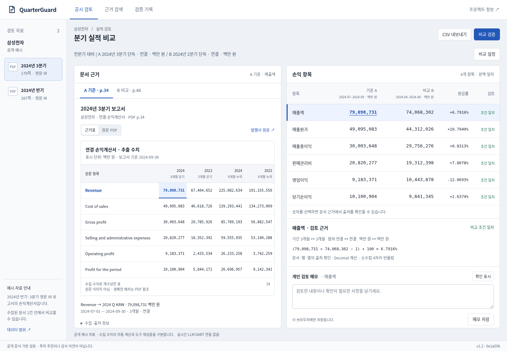
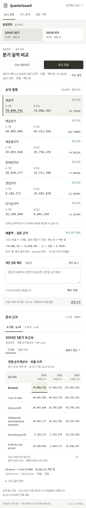
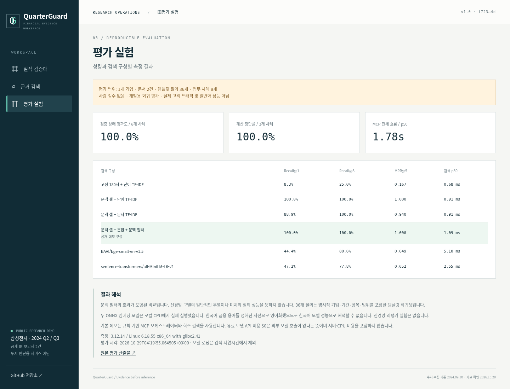
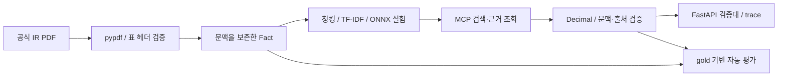

# QuarterGuard

**같은 통화, 다른 기간. 숫자가 맞아도 비교는 틀릴 수 있습니다.**

분기·누적, 연결·별도, 단위·참고 환산액 혼동을 막는 **공시 검토 도구**입니다. 실제 공개 보고서의 수치를 검색하고, 출처와 문맥을 확인한 뒤 계산합니다. 잘못된 입력 조합은 확인 필요로 남깁니다.

[공개 데모](https://quarterguard.onrender.com) · [v1.3 보완·검증 보고](docs/completion-report.md) · [공고 재대조](docs/job-fit-audit.md) · [평가 원본](artifacts/evaluation.json) · [조사와 주제 선정](docs/research.md) · [실제 데모 조사·화면 재구성](docs/live-demo-research.md) · [실패와 개선](docs/failures.md) · [요구사항 대응](docs/requirements.md)

## 문제 → 검증

삼성전자 2024년 3분기 보고서 p34에는 3개월 매출 **79,098,731**과 9개월 누적 **225,082,634**가 같은 행에 있습니다(백만 KRW). 기간을 잃어버린 청크에서 값만 가져오면 잘못된 성장률을 만들 수 있습니다.

1. **근거 검색:** 기간·항목·범위·통화를 보존한 셀 검색.
2. **문맥 검사:** 기업/항목/연결 범위/기간/통화/단위/출처 대조.
3. **수치 계산:** Decimal 계산 또는 불일치 시 중단.
4. **독립 근거 대조:** 9개월 누적 − 반기 누적 = 직접 공시된 3분기 값.
5. **검증 기록:** 실제 MCP 도구·입력·출력·시간을 JSON으로 제공.

예: `(79,098,731 ÷ 74,068,302 − 1) × 100 = 6.7916%`.
누적 차감은 `225,082,634 − 145,983,903 = 79,098,731`입니다. [수치와 위치](data/facts.json)

참고 달러 환산액은 보고서별 환율이 달라 계산을 차단합니다. 이 문제는 독립 AI 리뷰에서 발견하고 회귀 테스트로 수정했습니다. [검증 기록](docs/failures.md)

## 실제 화면

사용자가 선택한 Ramp Accounting의 밝고 평평한 작업면을 참고했습니다. 흰 본문에 넓은 비교표와 오른쪽 문서 근거를 연결하고, 반복되는 둥근 패널과 청회색 바탕을 제거했습니다. 기능과 데이터 범위는 그대로입니다.



<details><summary>모바일과 평가 화면</summary>





</details>

**추천 체험:** 보고서 목록에서 근거 선택 → 매출액 A/B 숫자 클릭 → 문서·행·열 확인 → 메모와 개인 확인 표시 → CSV 내보내기. `비교 설정`에서 B 기간을 누적으로 바꾸면 계산이 차단됩니다. 초기화 후 `비교 검증`을 누르면 실제 MCP 실행과 상세 기록을 확인할 수 있습니다.

- `표 계산`: 수집한 정본 수치에 문맥 검사와 Decimal 계산 적용. 현재 MCP 호출 없음.
- `비교 검증`: 실제 MCP stdio 세션에서 6개 항목의 근거 조회·비교 도구를 총 18회 호출. 실패하면 이전 결과를 지움.
- `근거표`: 수집 수치로 재구성한 표. `원문 PDF`는 발행사 원문을 직접 열며 외부 차단 시 새 탭 링크와 근거표를 제공.
- `검증 기록`: 6개 검색 구성, 8개 회귀 사례의 상태·원인·수치·인용 확인. 저장 결과 재생과 실제 MCP 실행을 구분.
- `개인 검토 메모`: 정확히 같은 수치 쌍·문서 버전·비교 방식에 묶인 브라우저 저장. 개인 확인은 자동 판정을 변경하지 않습니다. 다른 기기로 동기화되지 않으며 저장 실패를 표시합니다.
- `CSV 내보내기`: 6개 항목의 값·기간·범위·통화·배율·출처·자동 판정·개인 확인·메모를 포함합니다. 실행 중이나 실패 후에는 비활성화됩니다.
- `외부 API`: DART 고정 조회와 IR 수치 대조, 실제 호출/캐시/실패/차단 표시. LLM 설명 경로는 구현했으나 비용 승인·지속 사용량 기록·서버 키 조건을 모두 충족하기 전에는 호출하지 않습니다. [범위와 비용 통제](docs/public-providers.md). 계획은 규칙 기반이며 LLM 자율 에이전트가 아닙니다.

**외부 API 실호출 검증 완료(2026-10-29):** OpenAI 설명 생성 **4/4 구조 필드 검증 통과**, DART 조회 4회로 **16/16 재무 금액 일치**. [실행 근거·응답·한계](docs/live-verification.md). **이 4회/16개 기록은 공개 데모와 분리된 과거 수동 Actions 검증**이며, LLM 설명의 용어상 모호함 한 건도 원문과 함께 기록했습니다.

삼성전자는 **수집·평가한 예시 기업 1곳**입니다. 트레져러와의 관계나 다중 기업 지원을 뜻하지 않습니다. 제품 흐름은 문서와 수치 대조에 맞추고, 화면에 데이터 범위를 명시했습니다.

## 평가 결과

**1개 기업 / 문서 2건 / 표 4개 / 수치 192개 / 템플릿 검색 질의 36개 / 업무 사례 8개.**

|검색 구성|Recall@1|Recall@3|MRR@5|검색 p50|
|---|---:|---:|---:|---:|
|고정 180자 + 단어 TF-IDF|8.3%|25.0%|0.167|0.84 ms|
|문맥 셀 + 단어 TF-IDF|100.0%|100.0%|1.000|0.96 ms|
|문맥 셀 + 문자 TF-IDF|88.9%|100.0%|0.940|1.10 ms|
|문맥 셀 + 혼합 + 문맥 필터|100.0%|100.0%|1.000|1.17 ms|
|BGE-small-en-v1.5 (ONNX)|44.4%|80.6%|0.649|7.66 ms|
|MiniLM-L6-v2 (ONNX)|47.2%|77.8%|0.652|2.74 ms|

문맥 셀 단어 TF-IDF도 100%이므로 문맥 필터가 정상 질의 정확도를 추가 개선했다고 주장하지 않습니다. 필터의 가치는 미지원·모순 조건의 잘못된 후보 반환을 막는 회귀 테스트에서 확인합니다. 고정 청크와 셀 청크는 청크 개수/정보량이 다르므로 완전히 통제된 모델 비교가 아닙니다.

업무 8개에서 **상태·기대 원인·정확한 인용 일치**, 계산 가능한 3개에서 **수치 정답**을 대조합니다. [최신 측정값](artifacts/evaluation.json), [업무 gold](data/cases.json), [검색 gold](data/retrieval_gold.json), [준비된 실행 기록](artifacts/prepared.json).

평가셋은 프로그램 작성 템플릿과 회귀 사례이며 **사람 검수 없음, 독립 보류셋 아님, 일반화 성능 아님**입니다. 영어 임베딩에는 정해진 한국어 금융 용어 치환을 적용했습니다. 신경망 재랭커와 LLM-as-judge는 사용하지 않았습니다.

위 검색·MCP 평가의 유료 모델 API 호출은 0회/$0이며 (별도 OpenAI 실호출 검증 비용은 제외) 이는 서버·CPU·다운로드 비용을 포함하지 않습니다. 검색 시간은 인덱스 생성과 모델 로딩을 제외하고, MCP 전체 흐름은 subprocess 초기화를 포함합니다. 환경/모델 해시/개별 rank/latency는 평가 JSON에 있습니다. 최초 정답 오기와 수정 전 수치 정확도 2/3도 [원본 기록](artifacts/initial-label-audit.json)에 보존합니다.

## 새 문서 평가와 공개 API 보완 (v1.3)

2025년 같은 기업의 공식 반기·3분기 문서 2건을 개발 자료와 분리하고 **64개 수치·40개 사례**를 첫 실행 전 고정했습니다. AI 작성 정답이며 사람/전문가 검수는 없습니다. 새 기업 자료는 추가하지 않았습니다. 최초 결과와 수정 후 회귀 결과를 모두 [평가 원본](artifacts/heldout-evaluation.json), [출처·정답 방법·실패 전체](docs/heldout-evaluation.md)에 남겼습니다.

|평가 단계|최초 결과|수정 후 회귀 결과|
|---|---:|---:|
|원문 파싱|0/4|0/4|
|수동 수치 fixture 기반 검색|5/10 (제어 질의 5/5, 자연어 0/5)|5/10|
|fixture 기반 계산·불일치 탐지|8/8|8/8|
|fixture 기반 기간·범위·단위 등 문맥|10/10|10/10|
|fixture 기반 출처 검증|5/8|8/8|

출처 검증에서 금액·배율·기업 위조를 놓치던 문제를 고쳤습니다. 정본 금액과 문맥을 확인하며 동등한 단위 환산은 허용합니다. 수정 후 결과는 이미 공개한 사례의 회귀 결과이므로 새 보류셋 성능으로 표현하지 않습니다. 파서는 2024년 표 헤더에 고정돼 새 문서를 거부하고, 자연어 검색 5건도 실패합니다. 후속 계산/검색은 별도 fixture와 manifest를 주입한 평가이며 **PDF부터 답변까지 성공한 결과가 아닙니다**. 2025 Q3 원문의 순이익 행 내부 불일치도 정답을 고쳐 숨기지 않고 `NUMERIC_CONFLICT`로 기록했습니다.

DART 조회 경로는 구현했지만, 이번 공개 서버 확인에서는 `KEY_NOT_CONFIGURED`로 차단돼 새 실호출 0회입니다. 키 등록 완료 응답과 실행 환경 상태가 달라 저장·재배포 확인을 요청했습니다. [현재 연결 상태](https://quarterguard.onrender.com/api/providers)를 화면에도 그대로 표시합니다. 공개 DART는 키를 서버에만 두고 4개 고정 조회, 성공 캐시 24시간, 전역 60초 간격, 인스턴스 기록 기준 일 8회/누적 200회로 제한합니다. 무료 서버 재시작 시 이 기록은 사라질 수 있습니다. 유료 LLM은 이 한계를 그대로 허용하지 않고 **지속 기록 없이는 차단**합니다. 최대 20회/$0.20 보수적 예상 API 예산안은 문서화했으나 승인·유료 서비스 전환·새 유료 호출을 하지 않았습니다. 실제 공개 검증 횟수와 배포 SHA는 [최종 보고](docs/completion-report.md)에 구분합니다.

## 실행

Python 3.12 권장. 기본 실행에는 API 키와 모델 다운로드가 필요 없습니다. 공개 데모는 무료 Render 서비스라 유휴 상태 이후 첫 접속 시 대기 시간이 발생할 수 있습니다.

```bash
git clone https://github.com/sokldjs554/quarterguard.git
cd quarterguard
python -m venv .venv
source .venv/bin/activate  # Windows: .venv\Scripts\activate
pip install -r requirements.txt
python -m uvicorn quarterguard.api:app --host 0.0.0.0 --port 8000
```

`http://localhost:8000`에서 공시 대조 작업지를 엽니다. `.env.example`은 서버 키와 선택적 공급자 통제 설정 안내이며 기본 앱은 `.env`를 자동 로드하지 않습니다.

```bash
python -m unittest discover -s tests -v
python -m quarterguard.evaluate --cases-only
python scripts/check_artifacts.py
# 브라우저 저장/CSV 로직 (Node 22+)
node --test tests/test_review_notes.mjs
# 희소 검색 4개 구성과 실제 MCP 평가 (dense 결과는 이 실행에서 미포함)
python -m quarterguard.evaluate
# ONNX 모델 두 종까지 다시 평가
pip install -r requirements-eval.txt
HF_HOME="$PWD/work/hf" HF_HUB_DISABLE_XET=1 python -m quarterguard.evaluate --dense
# 원문 재수집·파싱 (PDF는 work/raw에만 저장)
python -m quarterguard.ingest --download
```

전체 평가 명령은 artifacts를 갱신합니다. 신경망 모델의 최초 다운로드에는 인터넷과 저장 공간이 필요합니다. 코드/데이터 변경 후 과거 평가를 최신처럼 사용하지 마세요.

브라우저 재현: `pip install playwright` 후 Chromium을 설치하고 `scripts/browser_check.py`의 실행 경로를 환경에 맞추세요. 서버 실행 후 `DEMO_URL=http://127.0.0.1:8000 python scripts/browser_check.py`. 실제 검사 viewport는 PC 1440×1000, 모바일 390×844입니다. 기존 v1.2.1 검증은 Python 54개·Node 5개·브라우저 37개였습니다. v1.3 최신 테스트 수와 HTTPS 직접 접속 여부는 [최종 보고](docs/completion-report.md), [브라우저 결과](artifacts/browser-check.json)에 구분합니다.

## 구조와 기술 선택



|기술|사용 이유|
|---|---|
|Python·FastAPI|문서/수치/도구 검증을 같은 코드로 API에 연결|
|pypdf|페이지별 텍스트·표 헤더를 재현 가능하게 읽기|
|Decimal|금융 수치 계산에서 이진 float 오차 배제|
|scikit-learn TF-IDF|작은 코퍼스의 투명하고 저비용인 검색 기준선|
|FastEmbed·ONNX|CPU에서 두 임베딩 모델을 실제 비교; 기본 배포에서 모델 로딩 비용 제외|
|MCP Python SDK|실제 initialize/list_tools/call_tool stdio 통신|
|HTML/CSS/JS|채팅 없는 가벼운 검증 워크스페이스와 반응형 UI|
|unittest·Playwright·GitHub Actions|금융 반례, API/MCP 통합, 브라우저 흐름과 CI|

MCP 서버: `python -m quarterguard.mcp_server`. 4개 도구: `search_documents`, `get_fact`, `verify_comparison`, `reconcile_quarter`. 원격 공개 MCP endpoint는 제공하지 않으며 웹 서버가 내부 stdio로 사용합니다.

## 데이터·제약

[데이터 명세](docs/data.md), [manifest](data/sources.json), [이용 조건 확인 기록](docs/research.md).

공식 영문 IR 문서의 선택된 수치 사실만 배포합니다. PDF 원본·전체 본문·원문 스크린샷은 포함하지 않습니다. 코드 MIT 라이선스는 보고서/모델에 적용되지 않습니다.

파서는 해당 2024년 표의 레이아웃에 한정합니다. DART는 과거 CI의 4회/16개 대조와 공개 고정 조회 경로를 구분하며 기본 IR 코퍼스와 자동 통합하지 않습니다. 자유 자연어 질문, 다중 기업, 범용 OCR, 정정공시, 신경망 재랭킹, 실제 고객 트래픽, 영구 운영 로그, 생성형 LLM 계획은 완료 범위가 아닙니다.

검색은 예시처럼 삼성전자·연도·분기·연결/별도·항목·3개월/누적·통화를 명시한 제어 어휘를 지원합니다. 미지원 어휘·기업·통화 또는 충돌 조건은 빈 결과로 처리하며 범용 자연어 이해를 주장하지 않습니다.

## 개발 근거

[설계·주제 비교](docs/design.md) · [실제 데모 조사·구현](docs/live-demo-research.md) · [조사한 제품과 SK Family README](docs/research.md) · [실패/수정 기록](docs/failures.md) · [직무 요구사항 대응](docs/requirements.md).

본 프로젝트는 AI 코딩 도구로 작성하고 별도 AI 리뷰 및 자동 검증을 수행했습니다. 사람 협업·전문가 검수·고객 운영 경험으로 주장하지 않습니다. 금융 투자 추천이나 감사 의견을 제공하지 않습니다.
