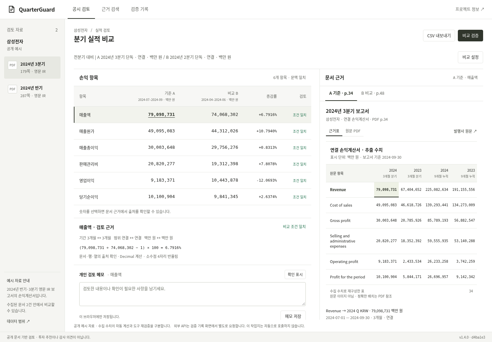

# QuarterGuard

**숫자가 맞아도 기간·범위가 다르면 비교는 틀릴 수 있습니다.**

공식 금융 문서의 근거를 찾아 기간·연결 범위·통화·단위를 확인하고, 계산하거나 판단을 보류하는 검토 도구입니다. 규칙 기반의 실제 MCP 실행과 DART 대조를 제공하며, 자율 LLM 에이전트로 표현하지 않습니다.

[공개 데모](https://quarterguard.onrender.com) · [v1.4 보완 보고](docs/completion-v1.4.md) · [현재 공고 대조](docs/job-fit-v2.md) · [새 평가와 실패 전체](docs/evaluation-v2.md) · [직접 코드 검토](docs/code-review-kit/README.md) · [사용자 검증 양식](docs/validation-kit/README.md)

## 직접 확인하기

공개 작업지는 **삼성전자 2024 반기·3분기 문서 2건, 정본 192개**를 유지합니다. 새로운 기간·기업의 평가 자료를 자동으로 제품에 등록하거나, 모든 문서를 지원한다고 표시하지 않습니다.

1. 매출액 A/B 수치 선택 → 원문 PDF·페이지·행·열 확인.
2. `비교 설정`에서 분기/누적 또는 연결/별도 조건을 바꾸어 보류되는 이유 확인.
3. `비교 검증`으로 실제 MCP 18회 도구 실행과 JSON 기록 확인. 준비된 기록 재생과 구분합니다.
4. `근거 검색`에서 한국어/영어 조건 검색. 빠진 조건은 확인 요청, 검색 결과는 후보로 표시합니다.
5. `검증 기록 → 외부 API 직접 확인`에서 DART 대조 요청. 실제 요청·캐시·차단·실패를 구분합니다.

자연어 예: `삼성전자 2024년 3분기 연결 매출액 3개월 백만원` 또는 `What was Samsung consolidated revenue for Q3 2024 quarter in million KRW?`. 조건이 없는 자유 질문을 임의로 채워 답하지 않습니다. 검색 후보를 선택한 뒤에도 계산·출처 검증이 필요합니다.

현재 제품 화면은 흰 작업면·비교표·문서 근거를 연결하는 기존 흐름을 유지합니다. 채팅 UI로 변경하지 않았습니다. 개인 메모/확인 표시는 이 브라우저에 저장하며 자동 금융 판정을 변경하지 않습니다.



## 파싱과 검색: 개선과 남은 실패

|구분|원문에서 확인한 결과|평가 해석|
|---|---|---|
|2024 개발 회귀|192/192 정본 수치·출처 동일|기존 기능 회귀|
|2025 공개된 실패 수정|원문 0/4 → 4/4 표, 기존 정답 64/64 일치|이미 본 실패로 수정한 결과|
|2023 삼성·현대 첫 별도 평가|원문 0/5 표|첫 실패 결과 그대로 보존|
|같은 2023 자료의 공개 후 수정|원문 4/5 표, 64/80 수치; 현대 표 미지원|새 보류셋 성능이 아닌 수정 회귀|
|마지막 별도 2022 Q3 표|원문 1/1 표, 16/16 수치·인용, 질의 8/8, 계산 2/2|작은 별도 고정 표본; 평가용 격리 정본 등록 사용|

원문 단계는 실제 PDF 추출 결과를 사용합니다. **fixture 단계는 준비된 정답 수치를 주입한 별도 진단**입니다. 새 자료의 실제 제품 등록은 하지 않았습니다. 새 정답은 같은 작업의 별도 AI가 작성·동결했으며 **사람/전문가 검수 없음**입니다. 삼성의 일부 비교 연도 금액은 과거 문서와 겹치므로 전부 처음 보는 금융 값이라고 주장하지 않습니다. [출처·동결·각 단계·실패 원본](docs/evaluation-v2.md).

고정 연도 헤더, 줄바꿈된 수치, 헤더의 쉼표, 단위·주석·행 경계를 검사하도록 파서를 수정했습니다. `Adjusted Gross profit`을 정식 `Gross profit`으로 오인하는 문제도 별도 AI 리뷰에서 발견해 고쳤습니다. [코드·회귀 근거](docs/parser-v2.md).

기존 자연어 5건은 정답 후보 Recall@5 5/5, top1 3/5이지만 **모두 빠진 조건이 있어 확인 필요**, 검증된 답변 0건입니다. 별도 2023 fixture 질의는 첫 20/24 → 공개 후 24/24이고, 원문 단계는 현대 파싱 실패 때문에 20/24입니다. 후보 검색 지표를 답변 정확도로 바꾸어 표현하지 않습니다. [검색 설계·한계](docs/search-v2.md).

## 청킹·임베딩·실제 리랭킹

기존 6개 검색 구성의 결과를 보존하고, 실제 CPU ONNX cross encoder `Xenova/ms-marco-MiniLM-L-6-v2`를 추가했습니다. 같은 질의·정답·top20 후보에서 비교했습니다.

|같은 후보의 비교|혼합 검색 Recall@1|Cross encoder Recall@1|p50 혼합 → 리랭커|
|---|---:|---:|---:|
|개발 36질의|100.0%|80.6%|1.52 → 149.47 ms|
|2023 별도 자료 첫 평가 · 정답 있는 14질의|50.0%|50.0%|1.24 → 128.16 ms|
|마지막 2022 · 정답 있는 6질의|66.7%|83.3%|1.19 → 104.66 ms|

마지막 작은 표본에서 혼합 검색보다 한 건 좋아졌지만 단어 TF-IDF는 6/6이었습니다. 리랭커를 기본 검색에 배포하지 않았습니다. 문맥 필터는 리랭커와 별개이며, 필터 뒤 후보가 하나인 결과는 신경망의 이득을 입증하지 않습니다. 고정180자/셀청크의 정보량과 청크 수, 캐시된 모델 로딩, CPU 환경 차이를 명시했습니다. [전체 Recall/MRR/지연·모델 해시·불리한 결과](docs/ranking-v2.md).

## 설명·도구·외부 API 검증

기존 실제 GPT 응답 4개를 추가 규칙으로 재검사했습니다. 2개는 사람 검토 대상으로 표시되며 **2개 오류 확정이라는 뜻이 아닙니다**. 합성 개발 반례21개는 기대 판정21/21이지만 일반 환각 탐지 정확도가 아닙니다. 문장 전체 의미는 검증 완료로 표시하지 않습니다. 새 유료 LLM 호출과 LLM-as-judge는 사용하지 않았습니다. [문장·숫자·인용 평가](docs/explanations-v2.md).

MCP는 검색→근거→문맥 검사→계산/보류의 규칙 기반 흐름입니다. 실제8개 흐름·직접 잘못된입력 검사·명시적 실패주입을 구분합니다. 시간 초과/전송 실패의 시도 단계도 남기고, 형식이 잘못된 JSON을 도구 성공으로 처리하지 않도록 보강했습니다. [실제 trace와 실패 처리](docs/mcp-v2.md).

DART는 삼성전자2024 반기·3분기×연결·별도4개 조회만 허용합니다. 서버 키,24시간 캐시,60초 간격,인스턴스 기록 기준 일8회/누적200회 제한을 적용합니다. 무료 서버 재시작 시 기록이 초기화될 수 있습니다. LLM은 키·유료 승인·지속 원장이 모두 없으면 차단합니다. [범위·비용 통제](docs/public-providers.md).

과거 실제 호출은 Actions OpenAI4회, Actions DART4회, 공개 데모 DART4회입니다. 이번 작업의 추가 호출 수와 비용은 [최종 보고](docs/completion-v1.4.md)에 별도로 기록하며 과거 기록을 새 호출로 합산하지 않습니다. 과거 [GPT 응답](artifacts/live-openai.json), [DART Actions](artifacts/live-dart.json), [DART 공개 검증](artifacts/public-dart.json)은 변경하지 않았습니다.

## 사람이 직접 확인할 부분

지인 일반 사용자와 회계 관련 참여 가능자가 있다는 사용자 진술은 확인했습니다. 실제 역할·경력·동의와 세션 수행은 아직 확인 전이며, 실제 참여자 사용·전문가 검수·고객 환경 배포 기록은 없습니다. [공개 자료 시나리오·동의·기록 양식](docs/validation-kit/README.md)을 준비했습니다. 참가자의 실제 관계/역할과 공개 범위에 동의받고, 관찰한 내용만 작성해야 합니다.

본인 코드 검토는 파서 실패/수정, 분기·누적/연결·별도 차단, DART/IR 단위 대조의 세 항목으로 준비했습니다. [함수·테스트·입출력·검토 질문](docs/code-review-kit/README.md). 사용자가 확인하기 전에는 본인 검토·오류 발견·수정 완료로 기록하지 않습니다.

## 실행과 재현

Python3.12 권장. 기본 앱은 API 키와 모델 다운로드 없이 실행됩니다. Render 무료 데모는 유휴 후 첫 접속에 대기가 발생할 수 있습니다.

```sh
git clone https://github.com/sokldjs554/quarterguard.git
cd quarterguard
python -m venv .venv
source .venv/bin/activate
pip install -r requirements.txt
python -m uvicorn quarterguard.api:app --host 0.0.0.0 --port 8000
python -m unittest discover -s tests -v
node --test tests/test_review_notes.mjs
python scripts/check_artifacts.py
```

현재 평가 재현은 [원문 평가](docs/evaluation-v2.md), [리랭킹](docs/ranking-v2.md), [LLM 규칙 검사](docs/explanations-v2.md)의 신규 출력 파일 명령을 사용하세요. 기존 실패 파일을 덮어쓰지 않습니다. 전체 PDF·모델 가중치·비밀키는 저장소에 포함하지 않습니다. `requirements-rerank.txt`는 로컬 선택적 실험이며 기본 배포 의존성이 아닙니다.

브라우저 검사는 PC1440×1000/모바일 크기390×844이며 물리 휴대폰 검증이 아닙니다. 직접 HTTPS와 TLS 검증 중계 결과를 구분합니다. 최신 테스트 수·배포 SHA·현재 한계는 [v1.4 보고](docs/completion-v1.4.md)와 [릴리스](https://github.com/sokldjs554/quarterguard/releases/tag/v1.4.0)에 기록합니다.

## 이전 근거와 적용 범위

[이전 v1.3.1 README](https://github.com/sokldjs554/quarterguard/blob/39b59bdfd222da6ead5bdf4e72feea5995a72e0d/README.md) · [이전 보완 보고](docs/completion-report.md) · [2025 첫 실패](data/heldout/first-run.json) · [초기 정답 오류](artifacts/initial-label-audit.json) · [제품 조사](docs/live-demo-research.md) · [SK Family README 조사](docs/research.md).

이 프로젝트는 AI 코딩 도구로 작성하고 별도 AI 리뷰와 자동 테스트로 검증했습니다. 지원자의 실제 코드 이해·협업·고객 경험을 대신 입증하지 않습니다. 코드 MIT 라이선스는 발행사 보고서·모델에 적용되지 않습니다. 투자 추천이나 감사 의견을 제공하지 않습니다.
