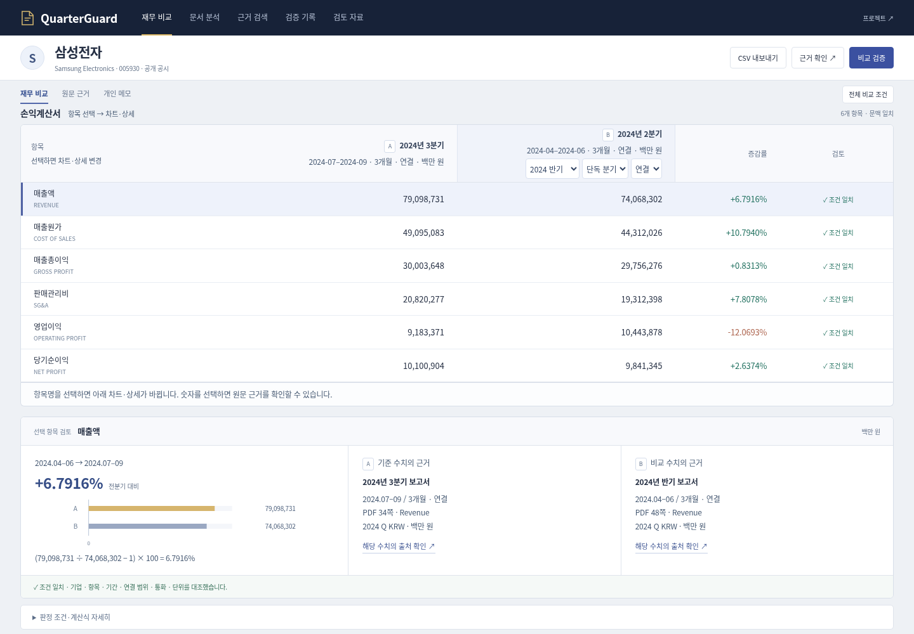
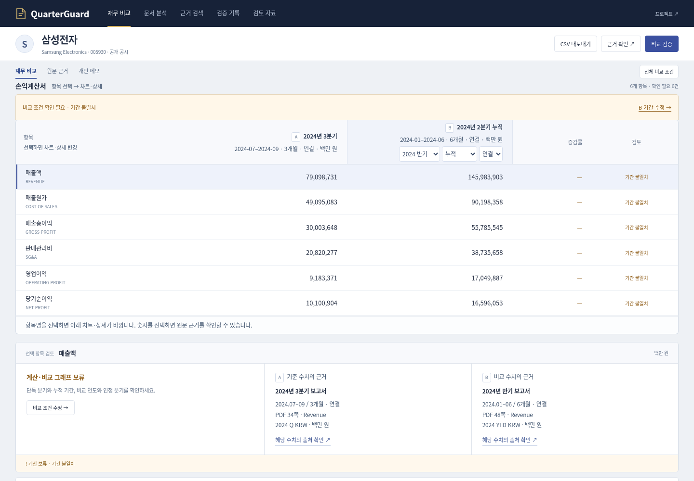
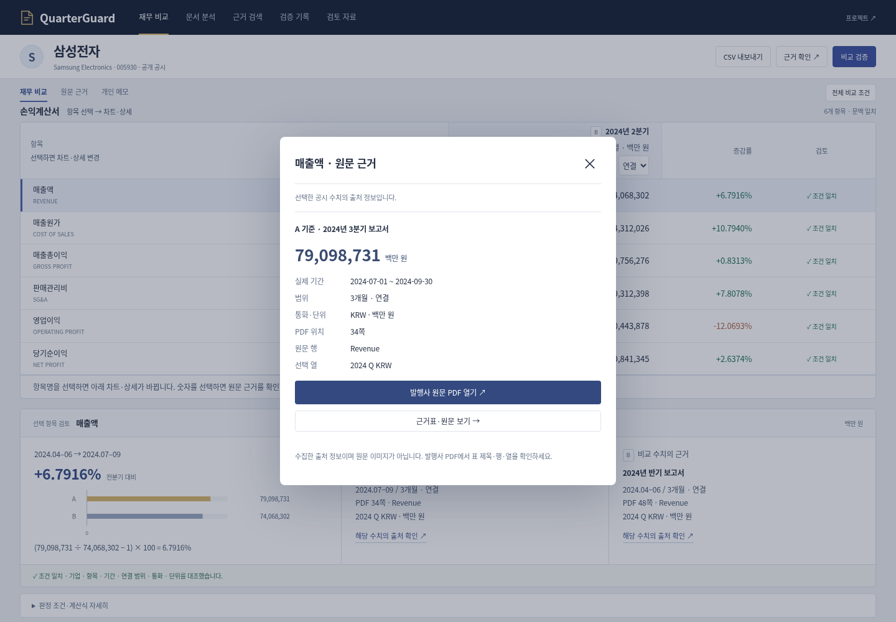
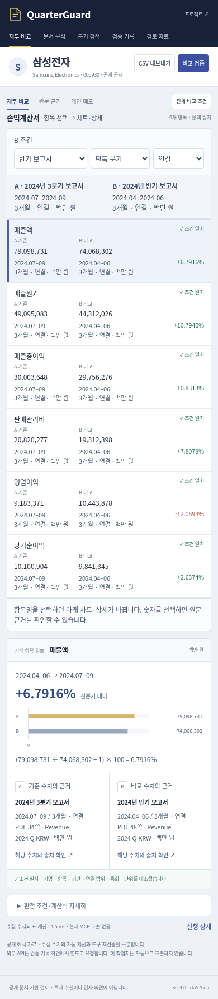
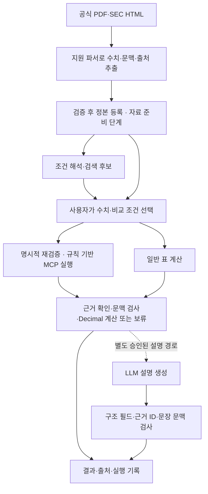

# QuarterGuard

기업 공시를 분석표·보고서로 옮기는 사람이 **수치의 원문 위치와 비교 조건을 함께 확인**하는 금융 검토 작업지입니다. 기간·연결 범위·통화·단위가 맞으면 계산하고, 다르면 이유를 표시하며 판단을 보류합니다. AI 코딩 도구를 활용한 개인 프로젝트입니다.

[공개 데모](https://quarterguard.onrender.com/#work) · [핵심 기술적 판단](#핵심-기술적-판단) · [본인 기여](#본인-기여와-수행-근거) · [공고 대조·지원 근거](docs/application-evidence-20261112.md) · [서버 버전](https://quarterguard.onrender.com/health)

## 공개 화면으로 보는 검토 흐름

**① 정상 비교 —** 삼성전자 2024년 3분기·2분기 연결 매출을 같은 3개월·백만 원 기준으로 대조합니다. 증가율은 **+6.7916%**입니다. 항목명을 누르면 아래 차트·상세가 바뀝니다.



<details>
<summary>② 기간 불일치 보류 · ③ 원문 확인 화면 펼치기</summary>

**② 기간 불일치 보류 —** B를 상반기 누적으로 바꾸면 3개월과 6개월이 섞입니다. **기간 불일치·계산 보류**를 표시하고 증감률을 비웁니다. 표 위 수정 버튼으로 조건을 바로잡습니다.



**③ 원문 확인 —** 숫자를 눌러 **문서·PDF 쪽수·행·열·기간·단위**를 확인하고 발행사 원문으로 이동합니다. 아래는 출처 정보 창이며 PDF 원문 이미지가 아닙니다.



</details>

캡처: **2026-11-15 KST, 공개 코드 `da576ea`**. 공개 서버의 실제 API 응답과 화면을 TLS 검증 중계로 확인했습니다. 이번 README 변경은 문서·캡처만 변경하며 제품 코드는 같습니다. [캡처 시각·서버 커밋·자산 해시](artifacts/readme-current-20261115/capture.json).

<details>
<summary>모바일 화면 보기</summary>



390px 브라우저 자동 캡처이며 실물 기기의 새 사람 검수는 아닙니다.

</details>

## 핵심 기술적 판단

### 1. 연도 고정 파서의 실패를 수정하되, 추출과 정답 검증을 구분

기존 파서는 `2024 2023` 연도 헤더와 2024년 날짜를 상수로 요구해 2025년 표 **4개 모두 파싱에 실패(0/4)**했습니다. 헤더에서 연도·분기/누적·통화·단위를 읽고 문서 메타데이터와 대조하도록 수정했습니다. 숫자의 줄바꿈은 유일하게 완성되는 쉼표 그룹만 연결하고, 행·열 수나 구조가 모호하면 거부합니다.

|대상·평가 구분|원문 PDF부터 처리한 결과|정답 대조 범위|
|---|---|---|
|2024 삼성 반기·3분기 / 기존 회귀|4개 표·192개 수치|기존 정본192개의 공개 필드 동일|
|2025 삼성 반기·3분기 / 알려진 실패 수정|**0/4 → 4/4개 표**, 192개 수치 추출|선언된 KRW 정답 **64/64**의 수치·문맥·출처 일치. 나머지128개 독립 정답 검수 아님|
|삼성2022 Q3 / 수정 후 별도 동결 평가|1개 표, 지정 KRW16셀 일치|격리 등록 후 질의8/8·계산2/2. 공개 작업지 등록과 구분|

첫 별도 2023 삼성·현대 표 평가의 원문 파싱 **0/5**도 보존했습니다. 당시 fixture 질의20/24 통과를 원문 파싱 성공으로 세지 않았습니다. 실패를 확인한 뒤 수정한 재평가는 개발 회귀로 구분합니다. 별도 동결 정답은 당시 AI 작성이었고, 새 문서 전체에 대한 사람 검수나 범용 파싱을 뜻하지 않습니다.

[실패·수정 코드 읽기](docs/code-review-kit/01-parser-2025.md) · [원문/fixture·첫 실패/후속 평가](docs/evaluation-v2.md) · [이후 현대차 지원 평가](docs/hyundai-holdout-20261109.md)

### 2. 청킹·임베딩·실제 리랭커를 비교하고 기본 검색에는 적용하지 않음

180자 고정 청크와 문맥을 포함한 셀 청크, word/character TF-IDF, 혼합 검색, BGE-small·MiniLM 임베딩을 비교했습니다. 개발36질의의 전체 코퍼스 검색에서 고정 청크 word R@1은 **0.0833**, 셀 word는 **1.0000**이었습니다. 고정 청크는 열 헤더를 잃고 셀 청크는 금융 조건을 포함하므로, 이 차이를 청크 크기 하나의 효과로 해석하지 않습니다.

아래는 **동일한 혼합 검색 top20 후보**를 놓고 비교한 별도 순위 실험입니다. 개발36개·별도2023 정답 존재14개 질의를 각각 사용했습니다. 별도 집합은 준비된 수치를 넣는 **fixture 기반 검색 평가**입니다.

|방법|개발 R@1|별도 R@1|별도 MRR@5|별도 p50(ms)|
|---|---:|---:|---:|---:|
|셀 word TF-IDF|1.0000|0.4286|0.6429|1.25|
|셀 혼합 검색|1.0000|0.5000|0.7143|1.24|
|BGE-small 임베딩|0.5278|0.4286|0.5917|10.01|
|MiniLM 임베딩|0.4722|0.5000|0.6512|6.22|
|실제 cross encoder|0.8056|0.5000|0.6964|128.16|

리랭커는 질의·후보 쌍에 실제 신경망 추론을 수행한 `ms-marco-MiniLM-L-6-v2`입니다. 문맥 필터와 구분합니다. 개발 성능은 낮아지고 별도 집합의 R@1은 같으면서 지연이 늘어 **기본 검색에 적용하지 않았습니다**. 추가2022 소표본에서는 혼합4/6 → 리랭커5/6이었지만 word6/6보다 낮고 p50은1.19→104.66ms였습니다. 공유 CPU의 소표본 측정이며 운영 지연시간 보장이나 일반적인 성능 향상으로 주장하지 않습니다.

[후보·모델·평가 조건과 전체 결과](docs/ranking-v2.md) · [첫 별도 평가 원결과](artifacts/ranking-v2-blind-first.json)

### 3. 같은 저장 응답의 자동 검사 통과 7→17건, 모호한 3건은 보류

금융 업무 경험자 b가 검수한 **같은 원응답20건**에서, 참으로 판정한 설명10건도 자동 검사에 막혔습니다. 날짜·금액·범위·출처를 연결하는 규칙과 계산식 인식을 보완해, 참17건을 통과시키고 모호3건은 계속 보류했습니다.

|동일한 저장 응답·기존 사람 판정|수정 전 자동 통과 / 보류|수정 후 자동 통과 / 보류|
|---|---:|---:|
|N01–N20 중 참17건|7 / 10|**17 / 0**|
|N01–N20 중 모호3건|0 / 3|**0 / 3**|
|이전 R배치의 거짓4·모호5건|0 / 9|**0 / 9**|

남긴 보류는 증가율 누락, 누적 차감값과 직접 공시값의 일치 결론 누락, 모호한 기간 표현입니다. 구조 필드·근거 ID가 맞아도 문장은 틀릴 수 있어 각각 검사합니다. **저장된 실제 응답의 무료 재검사이며 새 생성 효과가 아닙니다.** 사람 판정은 바꾸지 않았고, 수정에 사용한 개발 사례입니다. 추가 AI 합성80건의 회귀 결과도 사람 작성·새 독립 평가와 분리했습니다.

[원인·검사 코드·수정 전후 결과](docs/prose-binding-followup-20261113.md) · [같은 응답의 b 검수](docs/validation-kit/final-human-closeout-20261113/README.md)

## 아키텍처



자료 추출은 준비 단계이며, 화면을 열 때마다 PDF를 다시 파싱하지 않습니다. 일반 표 계산은 MCP를 호출하지 않고, **비교 검증**은 실제 stdio MCP를 호출합니다. 공개 작업지의 실행 순서는 규칙 기반입니다. 모델이 도구를 선택하는 제한형 실험은 별도 평가로 구분합니다. LLM 설명도 자동으로 유료 호출하지 않습니다.

[파싱](quarterguard/ingest.py) · [검색](quarterguard/search.py) · [작업지 실행](quarterguard/worksheet.py) · [MCP 도구](quarterguard/mcp_server.py) · [규칙·Decimal](quarterguard/core.py) · [설명 검사](quarterguard/prose_bindings.py)

## 본인 기여와 수행 근거

제품 구현·배포·자동 평가에는 AI 도움을 사용했습니다. 아래는 **작성자 윤기혁이 직접 수행했다고 확인하고 코드·출력·기록을 제출한 범위**입니다.

|본인 기여|확인된 내용|근거|
|---|---|---|
|진단 설명 코드 수정·제출|독립 재계산 진단을 도구의 실제 조건 실행 이력과 구분. `explanation_context.py` 수정 제출, 기존 계산 판정 유지. AI가 통합·별도 재검사 수행|[코드 제출 기록](docs/code-review-kit/04-period-diagnostic-author-20261110.md)|
|테스트6개 보강·실행|기간2개, DART 단위·중복 후보3개, 기간 진단1개. DART 테스트는 준비된 행을 쓰며 실API 조회가 아님|[기간2개](docs/code-review-kit/review-20261108.md) · [DART3개](docs/code-review-kit/review-dart-20261109.md) · [진단1개](docs/code-review-kit/05-period-diagnostic-test-20261111.md)|
|직접 실행한 전체 회귀|당시 macOS11.7.11·Python3.12.8에서 **143개 /46.507초/OK** 보고. 이후 진단 제출 시239개(1skip)·Node14개 보고. 최신 AI 검사406개·Node39개와 별도|[143개 실행](docs/code-review-kit/review-20261108.md) · [후속 실행 구분](docs/code-review-kit/05-period-diagnostic-test-20261111.md)|
|AI 없이 질문·답안12개 작성|SK하이닉스5개·Apple7개. 첫 실패를 평가한 뒤 수정에 사용했으며 현재는 개발 사례|[SK 작성 확인](data/skhynix-human-20261111/authorship-confirmation.json) · [Apple 작성 확인](data/apple-submitted-20261112/authorship-confirmation.json)|
|검토 진행·기록 전달|외부 참여자2명(a: 대학생, b: 금융 분야3년 경력의 친구)의 사용·검수 기록 전달과 후속 확인. 반복 검수는 새 참여자로 세지 않음|[a 사용 기록](docs/validation-kit/session-a-20261107.md) · [b 사용·검수 및 후속 확인](docs/validation-kit/final-followup-20261112/README.md)|

AI의 검토 안내·코드 형식 복원·환경 오류 해결과 본인 수행을 구분합니다. 위 참여는 공개 데모 검토이며 금융기관 내부 배포·조직 차원의 도입 실적으로 확대하지 않습니다.

## 직접 사용하기

1. [재무 비교](https://quarterguard.onrender.com/#work)에서 항목 선택 → 숫자 클릭 → 출처 확인 → B 기간/범위 변경 → 보류/복구를 확인합니다. **비교 검증 → 실행 상세**에서 실제 MCP 기록을 볼 수 있습니다.
2. [문서 분석](https://quarterguard.onrender.com/#analysis)에서 SK하이닉스 연간 실적·시점 잔액·제품 비중, Apple 공시 질문의 계산·판단 보류를 확인합니다. JSON 저장 후 **저장한 JSON 파일 확인**으로 화면과 대조합니다.
3. [근거 검색](https://quarterguard.onrender.com/#search)에서 조건을 입력해 후보를 찾고, [검증 기록](https://quarterguard.onrender.com/#review)에서 실제 실행·저장 결과와 과거 실패를 구분해 확인합니다. 개인 메모·25열 CSV는 재무 비교에서 제공합니다.

## 현재 제품 지원 범위


|영역|실제 지원|제한|
|---|---|---|
|분기 비교 작업지|삼성전자2024 반기·3분기 문서2건, 정본192개. 기간·연결/별도·통화 검증, 누적 차감, 실제 MCP 실행|등록 자료에 한정. 임의 PDF 업로드·전체 기업 지원 아님|
|SK하이닉스 근거 검색|2025 Offering Circular의2024·2023 연결 재무제표3쪽·18셀|선택 문서 조건을 명시. 검색 후보는 자동 계산 답변이 아님|
|Apple 선택 문서 검토|FY2024 SEC HTML 25셀·2문단, 매출총이익률·지역 매출·현금흐름·세금 대조|52/53주 고지, 개별 수익성·판매량 단독 원인 보류. 선택 문서·문법만 지원|
|SK하이닉스 선택 계산|연간 실적, 전년 말 현금·재고 잔액, 같은 표의 제품 매출 비중|음수 기저는 차이만 제공하고 증감률 보류. 재고 개월분은 정의 확인|
|현대차 등 추가 문서|공식 원문 파싱·격리 평가 기록|공개 기업 선택에 등록한 제품 기능은 아님|
|LLM 설명|공개 경로 모델 GPT-4.1-mini-2025-04-14. 호출은 키·승인·영속 사용량 기록 조건 충족 시만 가능|구조/문장 규칙 통과가 모든 의미의 정확성을 보장하지 않음|
|제한형 도구 선택 실험|두 명시적 검색 조건 안에서 검색·근거 조회·비교 도구 선택을 검사하는 별도 실행기|공개 자동 실행 기능 아님. [후속 실제 모델 선택·MCP 실행4/4](docs/model-completion-live-results-20261112.md), 해당 개발4과제에 한정. 이전3/4는 보존|

## 최신 검증 요약과 변경 기록

**제품 코드 `da576ea`, 2026-11-15 KST**의 AI 자동 검사 결과입니다. 본인 실행143개나 과거 모델·사람 검수 수치와 합산하지 않습니다. 이번 README 정리는 새 캡처·링크·기록 대조이며 아래 테스트를 새로 실행했다는 뜻은 아닙니다.

|검사|최신 결과·범위|
|---|---|
|Python 회귀|406개 실행, 실패0, 건너뜀1|
|Node|**39개 통과**. 이전 `26d37b5`의37개는 이력에 보존|
|실제 API·브라우저|로컬47개 / 공개45개. 각 실행에서 실제 MCP 도구18회, 유료 제공자0회|
|재검증 대기·실패|1440/390/320px에서18개. 응답 지연·재생, 오류 주입이며 실제 MCP 실행 수로 합산하지 않음|
|배치·배포|3개 화면 폭 확인. GitHub·Render·health의 `da576ea` 일치, 공개 HTML/CSS/JS 해시 대조|

[공개45개 검사](artifacts/readme-current-20261115/public-browser.json) · [대기·실패18개](artifacts/readme-current-20261115/public-pending.json) · [배치](artifacts/readme-current-20261115/public-layout.json) · [버전·해시](artifacts/readme-current-20261115/public-version-assets.json)

이번 UI 보완: 같은 조건의 재검증 중 **이전 표·차트 유지**, 요청 전송·응답 대기·결과 반영 표시, 대기 중 내보내기 잠금, 실패/조건 변경 시 이전 결과 제거. 기간·단위·선택 메뉴의 가독성과 항목 선택 안내도 개선했습니다. [변경·검사 상세](docs/workbook-feedback-20261115.md).

직접 HTTP 클라이언트 HTTPS/TLS 검증은 통과했습니다. 이 환경의 Chrome 직접 HTTPS는 인증서 신뢰 오류로 실패해, 공개 브라우저 동작은 **서버 TLS를 검증하는 고정 중계**로 확인했습니다. 인증서 검증을 끄지 않았으며, 실물 모바일·새 사람 검수와 구분합니다.

**[과거 변경·평가 기록](docs/readme-history.md)** — 이전 UI 캡처, Node37개와 당시 검사, 모델 실호출·사람 판정, 첫 실패와 후속 수정은 날짜·커밋별로 보존했습니다. [이번 정리 전 README 원문](artifacts/readme-current-20261115/README.before.md).

## 로컬 실행


Python3.12 권장. 기본 앱·회귀 테스트는 유료 API 호출 없이 실행합니다.

```bash
git clone https://github.com/sokldjs554/quarterguard.git
cd quarterguard
python -m venv .venv
source .venv/bin/activate
pip install -r requirements.txt
python -m uvicorn quarterguard.api:app --host 127.0.0.1 --port 8000
```

```bash
python -m unittest discover -s tests
node --test tests/*.mjs
python scripts/check_artifacts.py
python -m quarterguard.final_evaluation --dry-run --output work/new-free-mcp-run
```

`--dry-run`은 실제 MCP를 호출하지만 도구 선택은 준비된 테스트 순서이며 LLM 호출0회입니다. 출력 폴더는 새 경로를 사용합니다. PDF 캐시가 필요한 테스트는 캐시가 없으면 건너뜁니다.

## 분야별 원기록

[원문 파싱 평가](docs/evaluation-v2.md) · [검색·임베딩·리랭킹](docs/ranking-v2.md) · [LLM 설명 검사 보완](docs/prose-binding-followup-20261113.md) · [SK 최초 실패](docs/skhynix-human-baseline-20261111.md) · [Apple 최초 실패](docs/apple-first-evaluation-20261112.md) · [직접 코드 검토](docs/code-review-kit/README.md) · [사람 검수](docs/validation-kit/final-handoff-20261112/README.md)
