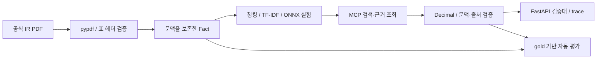

# QuarterGuard

**같은 통화, 다른 기간. 숫자가 맞아도 비교는 틀릴 수 있습니다.**

분기·누적, 연결·별도, 단위·참고 환산액 혼동을 막는 **분기 실적 비교 검증대**입니다. 실제 공개 보고서의 수치를 검색하고, 출처와 문맥을 확인한 뒤 계산합니다. 잘못된 입력 조합은 확인 필요로 남깁니다.

[공개 데모 — 배포 확인 후 링크 갱신](#실행) · [평가 원본](artifacts/evaluation.json) · [조사와 주제 선정](docs/research.md) · [실패와 개선](docs/failures.md) · [요구사항 대응](docs/requirements.md)

## 문제 → 검증

삼성전자 2024년 3분기 보고서 p34에는 3개월 매출 **79,098,731**과 9개월 누적 **225,082,634**가 같은 행에 있습니다(백만 KRW). 기간을 잃어버린 청크에서 값만 가져오면 잘못된 성장률을 만들 수 있습니다.

1. **근거 검색:** 기간·항목·범위·통화를 보존한 셀 검색.
2. **문맥 검사:** 기업/항목/연결 범위/기간/통화/단위/출처 대조.
3. **수치 계산:** Decimal 계산 또는 불일치 시 중단.
4. **독립 근거 대조:** 9개월 누적 − 반기 누적 = 직접 공시된 3분기 값.
5. **검증 기록:** 실제 MCP 도구·입력·출력·시간을 JSON으로 제공.

예: `(79,098,731 ÷ 74,068,302 − 1) × 100 = 6.7916%`.
누적 차감은 `225,082,634 − 145,983,903 = 79,098,731`입니다. [수치와 위치](data/facts.json)

참고 달러 환산액은 보고서별 환율이 달라 계산을 차단합니다. 이 문제는 독립 AI 리뷰에서 발견하고 회귀 테스트로 수정했습니다. [검증 기록](docs/failures.md)

## 실제 화면


<details><summary>모바일과 평가 화면</summary>


</details>

**추천 체험:** 분기 매출 증감 → 누적·분기 혼동 → 누적 차감 교차검증 → p.34 근거 상세 → 도구 실행 기록 → 평가 실험.

- `준비 결과`: 미리 실행한 MCP 결과 재생. 현재 모델/API 실행 없음.
- `MCP 실행`: 서버에서 실제 MCP stdio 세션과 도구를 다시 실행.
- 생성형 LLM은 사용하지 않습니다. 계획은 규칙 기반이며, 임베딩 모델 두 종은 검색 비교 실험에서 실제 실행했습니다. LLM 자율 에이전트로 과장하지 않습니다.

## 평가 결과

**1개 기업 / 문서 2건 / 표 4개 / 수치 192개 / 템플릿 검색 질의 36개 / 업무 사례 8개.**

|검색 구성|Recall@1|Recall@3|MRR@5|검색 p50|
|---|---:|---:|---:|---:|
|고정 180자 + 단어 TF-IDF|8.3%|25.0%|0.167|0.68 ms|
|문맥 셀 + 단어 TF-IDF|100.0%|100.0%|1.000|0.91 ms|
|문맥 셀 + 문자 TF-IDF|88.9%|100.0%|0.940|0.91 ms|
|문맥 셀 + 혼합 + 문맥 필터|100.0%|100.0%|1.000|1.09 ms|
|BGE-small-en-v1.5 (ONNX)|44.4%|80.6%|0.649|5.10 ms|
|MiniLM-L6-v2 (ONNX)|47.2%|77.8%|0.652|2.55 ms|

문맥 셀 단어 TF-IDF도 100%이므로 문맥 필터가 정상 질의 정확도를 추가 개선했다고 주장하지 않습니다. 필터의 가치는 미지원·모순 조건의 잘못된 후보 반환을 막는 회귀 테스트에서 확인합니다. 고정 청크와 셀 청크는 청크 개수/정보량이 다르므로 완전히 통제된 모델 비교가 아닙니다.

업무 8개에서 **상태·기대 원인·정확한 인용 일치**, 계산 가능한 3개에서 **수치 정답**을 대조합니다. [최신 측정값](artifacts/evaluation.json), [업무 gold](data/cases.json), [검색 gold](data/retrieval_gold.json), [준비된 실행 기록](artifacts/prepared.json).

평가셋은 프로그램 작성 템플릿과 회귀 사례이며 **사람 검수 없음, 독립 보류셋 아님, 일반화 성능 아님**입니다. 영어 임베딩에는 정해진 한국어 금융 용어 치환을 적용했습니다. 신경망 재랭커와 LLM-as-judge는 사용하지 않았습니다.

유료 모델 API 호출은 0회/$0이며 이는 서버·CPU·다운로드 비용을 포함하지 않습니다. 검색 시간은 인덱스 생성과 모델 로딩을 제외하고, MCP 전체 흐름은 subprocess 초기화를 포함합니다. 환경/모델 해시/개별 rank/latency는 평가 JSON에 있습니다. 최초 정답 오기와 수정 전 수치 정확도 2/3도 [원본 기록](artifacts/initial-label-audit.json)에 보존합니다.

## 실행

Python 3.12 권장. 기본 실행에는 API 키와 모델 다운로드가 필요 없습니다.

```bash
git clone https://github.com/sokldjs554/quarterguard.git
cd quarterguard
python -m venv .venv
source .venv/bin/activate  # Windows: .venv\Scripts\activate
pip install -r requirements.txt
python -m uvicorn quarterguard.api:app --host 0.0.0.0 --port 8000
```

`http://localhost:8000`에서 검증대를 엽니다. `.env.example`은 선택적 DART 키 안내이며 기본 앱은 `.env`를 자동 로드하지 않습니다.

```bash
python -m unittest discover -s tests -v
python -m quarterguard.evaluate --cases-only
python scripts/check_artifacts.py
# 희소 검색 4개 구성과 실제 MCP 평가 (dense 결과는 이 실행에서 미포함)
python -m quarterguard.evaluate
# ONNX 모델 두 종까지 다시 평가
pip install -r requirements-eval.txt
HF_HOME="$PWD/work/hf" HF_HUB_DISABLE_XET=1 python -m quarterguard.evaluate --dense
# 원문 재수집·파싱 (PDF는 work/raw에만 저장)
python -m quarterguard.ingest --download
```

전체 평가 명령은 artifacts를 갱신합니다. 신경망 모델의 최초 다운로드에는 인터넷과 저장 공간이 필요합니다. 코드/데이터 변경 후 과거 평가를 최신처럼 사용하지 마세요.

브라우저 재현: `pip install playwright` 후 Chromium을 설치하고 `scripts/browser_check.py`의 실행 경로를 환경에 맞추세요. 서버 실행 후 `DEMO_URL=http://127.0.0.1:8000 python scripts/browser_check.py`. 실제 검사 viewport는 PC 1440×1100, 모바일 390×844입니다. [검사 결과](artifacts/browser-check.json)

## 구조와 기술 선택



|기술|사용 이유|
|---|---|
|Python·FastAPI|문서/수치/도구 검증을 같은 코드로 API에 연결|
|pypdf|페이지별 텍스트·표 헤더를 재현 가능하게 읽기|
|Decimal|금융 수치 계산에서 이진 float 오차 배제|
|scikit-learn TF-IDF|작은 코퍼스의 투명하고 저비용인 검색 기준선|
|FastEmbed·ONNX|CPU에서 두 임베딩 모델을 실제 비교; 기본 배포에서 모델 로딩 비용 제외|
|MCP Python SDK|실제 initialize/list_tools/call_tool stdio 통신|
|HTML/CSS/JS|채팅 없는 가벼운 검증 워크스페이스와 반응형 UI|
|unittest·Playwright·GitHub Actions|금융 반례, API/MCP 통합, 브라우저 흐름과 CI|

MCP 서버: `python -m quarterguard.mcp_server`. 4개 도구: `search_documents`, `get_fact`, `verify_comparison`, `reconcile_quarter`. 원격 공개 MCP endpoint는 제공하지 않으며 웹 서버가 내부 stdio로 사용합니다.

## 데이터·제약

[데이터 명세](docs/data.md), [manifest](data/sources.json), [이용 조건 확인 기록](docs/research.md).

공식 영문 IR 문서의 선택된 수치 사실만 배포합니다. PDF 원본·전체 본문·원문 스크린샷은 포함하지 않습니다. 코드 MIT 라이선스는 보고서/모델에 적용되지 않습니다.

파서는 해당 2024년 표의 레이아웃에 한정합니다. DART API 수집 코드는 있으나 키가 없어 실제 호출을 검증하지 않았고 기본 IR 코퍼스와 자동 통합하지 않습니다. 자유 자연어 질문, 다중 기업, 범용 OCR, 정정공시, 신경망 재랭킹, 실제 고객 트래픽, 영구 운영 로그, 생성형 LLM 계획은 완료 범위가 아닙니다.

## 개발 근거

[설계·주제 비교](docs/design.md) · [조사한 제품과 SK Family README](docs/research.md) · [실패/수정 기록](docs/failures.md) · [직무 요구사항 대응](docs/requirements.md).

본 프로젝트는 AI 코딩 도구로 작성하고 별도 AI 리뷰 및 자동 검증을 수행했습니다. 사람 협업·전문가 검수·고객 운영 경험으로 주장하지 않습니다. 금융 투자 추천이나 감사 의견을 제공하지 않습니다.
