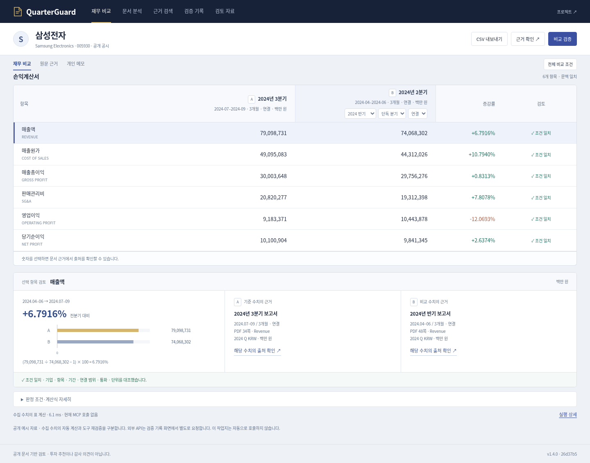
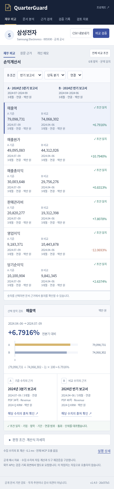

# QuarterGuard

공식 금융 문서의 **원문 근거·기간·연결 범위·통화·단위**를 확인해 계산하거나 보류하는 금융 검토 작업지입니다. AI 코딩 도구를 활용한 개인 프로젝트이며, 계산 판정은 규칙과 Decimal 연산으로 수행합니다.

[공개 데모](https://quarterguard.onrender.com/#work) · [지원 근거·공고 대조](docs/application-evidence-20261112.md) · [본인 코드 검토](docs/code-review-kit/README.md) · [사람 검수 기록](docs/validation-kit/final-handoff-20261112/README.md) · [서버 버전](https://quarterguard.onrender.com/health)

## 현재 데모

상단에서 작업을 선택하고, 삼성전자 비교표의 A/B 조건을 맞춘 뒤 선택 항목의 계산과 양쪽 원문 근거를 확인합니다. 모바일에서는 두 금액·판정을 함께 표시하고 각 금액 아래에 기간·범위·단위를 보여줍니다.



<details>
<summary>모바일 화면 보기</summary>



</details>

캡처 기준: **2026-11-15 KST, 공개 커밋 `26d37b5`**. 실제 공개 서버를 TLS 검증 중계로 열어 캡처했습니다. 이후 문서 변경 커밋과 화면 캡처 기준을 구분하며, 현재 서버 커밋은 `/health`에서 확인할 수 있습니다. [승인 시안·실제 제품 대조](docs/workbook-release-20261115.md) · [공개 배포·브라우저 검증](docs/workbook-public-verification-20261115.md).

|메뉴|할 수 있는 일|
|---|---|
|[재무 비교](https://quarterguard.onrender.com/#work)|삼성전자 손익 6개 항목 비교. 전체 비교 조건, 실제 MCP 재검증, 원문 근거·개인 메모, CSV 내보내기|
|[문서 분석](https://quarterguard.onrender.com/#analysis)|Apple 공시 질문의 근거·계산·보류 확인. SK하이닉스 연간 실적·시점 잔액·제품 비중 계산. JSON 저장·재확인|
|[근거 검색](https://quarterguard.onrender.com/#search)|한국어·영어 조건으로 삼성 분기 수치 후보 검색 후 작업지에서 대조|
|[검증 기록](https://quarterguard.onrender.com/#review)|최신·과거 평가, 저장 기록과 현재 재실행, DART·LLM 제공자 확인 기능|
|[검토 자료](https://quarterguard.onrender.com/#home)|삼성전자·SK하이닉스·Apple 작업 선택, 삼성 비교 작업지 보고서 목록|

## 5분 사용 순서

1. **재무 비교**에서 삼성전자 2024년 3분기 매출 **79,098,731백만 원**, 2분기 **74,068,302백만 원**, **+6.7916%**를 확인합니다. 숫자를 누르면 원문 근거 창이 열리며, **근거표·원문 보기**로 PDF 위치와 행·열을 확인합니다.
2. B의 기간을 **누적**, 범위를 **별도**로 바꿔 계산 보류를 확인합니다. 표 위 **B 기간 수정 / B 범위 수정**으로 조건을 고친 뒤 **설정 닫고 결과 보기**로 돌아옵니다. **전체 비교 조건**에서는 A/B 문서·연도·범위·기간·단위와 QoQ/YoY를 선택합니다.
3. **비교 검증 → 실행 상세**에서 실제 MCP 도구 실행을 확인합니다. 일반 조건 변경 시의 표 계산과 구분합니다. **개인 메모** 탭의 확인 표시는 계산 승인과 별개이며, 메모와 기존 **25열 CSV**를 유지합니다.
4. **문서 분석**에서 SK하이닉스를 선택하고 **선택 근거로 계산**을 펼칩니다. 현금 증감 **47.6820%**, DRAM 비중 **67.5777%**, 음수 기준값의 증감률 보류와 재고 개월분의 정의 확인을 살펴봅니다.
5. 문서를 Apple로 바꾸고 **질문의 근거·계산 검증**을 실행합니다. 제품·서비스 매출총이익률 **37.1806% / 73.8804%**와, 개별 수익성·판매량 단독 원인 질문의 판단 보류를 확인합니다.
6. 분석 결과를 JSON으로 저장한 뒤 **저장한 JSON 파일 확인**에서 내려받은 파일을 선택해 현재 결과와 대조합니다. 파일은 브라우저 안에서 읽습니다. 질문이나 조건을 바꾸면 이전 결과와 저장 상태가 초기화됩니다.

## 현재 제품 지원 범위

|영역|실제 지원|제한|
|---|---|---|
|분기 비교 작업지|삼성전자2024 반기·3분기 문서2건, 정본192개. 기간·연결/별도·통화 검증, 누적 차감, 실제 MCP 실행|등록 자료에 한정. 임의 PDF 업로드·전체 기업 지원 아님|
|SK하이닉스 근거 검색|2025 Offering Circular의2024·2023 연결 재무제표3쪽·18셀|선택 문서 조건을 명시. 검색 후보는 자동 계산 답변이 아님|
|Apple 선택 문서 검토|FY2024 SEC HTML 25셀·2문단, 매출총이익률·지역 매출·현금흐름·세금 대조|52/53주 고지, 개별 수익성·판매량 단독 원인 보류. 선택 문서·문법만 지원|
|SK하이닉스 선택 계산|연간 실적, 전년 말 현금·재고 잔액, 같은 표의 제품 매출 비중|음수 기저는 차이만 제공하고 증감률 보류. 재고 개월분은 정의 확인|
|현대차 등 추가 문서|공식 원문 파싱·격리 평가 기록|공개 기업 선택에 등록한 제품 기능은 아님|
|LLM 설명|공개 경로 모델 GPT-4.1-mini-2025-04-14. 호출은 키·승인·영속 사용량 기록 조건 충족 시만 가능|구조/문장 규칙 통과가 모든 의미의 정확성을 보장하지 않음|
|제한형 도구 선택 실험|두 명시적 검색 조건 안에서 검색·근거 조회·비교 도구 선택을 검사하는 별도 실행기|공개 자동 실행 기능 아님. 실제4과제 실행:3개 기준 일치·1개 안전 차단. 새 무제한 자율 실행 아님|

## 최신 UI 검증과 근거

아래는 **2026-11-15 워크북 UI 적용**의 검사 결과입니다. 과거 모델 평가·사람 검수 결과와 합산하지 않습니다.

|검증|결과·범위|
|---|---|
|기존 Python 회귀|406개 실행, 실패 0, 1개 건너뜀|
|Node 테스트|37개 통과|
|실제 로컬 API·브라우저|PC·모바일 47항목 통과. HTTP 503 주입 후 이전 결과 제거·복구 포함|
|공개 서버 브라우저|PC·모바일 45항목 통과. 실제 MCP 18개 도구 실행 포함|
|배치·키보드|1440 / 390 / 320px 확인. 모바일의 숨은 중복 선택칸 Tab 진입 문제 수정·재확인|
|배포 일치|캡처 당시 GitHub·Render·`/health`의 `26d37b5` 일치. 공개 HTML·변경 CSS/JS 5개 파일 해시 일치|
|이번 UI 변경의 유료 호출|LLM·유료 제공자 0회. 기존 실호출 평가는 아래 원기록에 보존|

[공개 검사 원결과](artifacts/workbook-public-20261115/browser.json) · [배치 측정](artifacts/workbook-public-20261115/layout.json) · [버전·자산 대조](artifacts/workbook-public-20261115/version-assets.json).

브라우저 검증은 AI가 실행한 자동 검사이며 실물 모바일·새 사람 검수로 집계하지 않습니다. 직접 HTTP 클라이언트의 HTTPS/TLS 검증은 통과했습니다. 이 실행 환경의 Chrome 직접 HTTPS는 인증서 신뢰 오류로 실패해, 공개 동작은 **원본 서버 TLS를 검증하는 고정 중계 경로**로 확인했습니다.

**기존 본인 수행·사람 참여 근거도 유지합니다.** 본인의 기간·DART·진단 테스트 6개와 AI 없이 작성한 금융 질문 12개, 외부 참여자 2명(a: 대학생, b: 금융 분야 3년 경력의 친구)의 실제 사용·후속 검수는 각 원기록의 수행 범위로 구분합니다. 금융기관 내부 배포나 새 UI의 사람 재검수로 확대하지 않습니다.

## 로컬 실행

Python3.12 권장. 기본 앱·회귀 테스트는 유료 API 호출 없이 실행합니다.

```bash
git clone https://github.com/sokldjs554/quarterguard.git
cd quarterguard
python -m venv .venv
source .venv/bin/activate
pip install -r requirements.txt
python -m uvicorn quarterguard.api:app --host 127.0.0.1 --port 8000
```

```bash
python -m unittest discover -s tests
node --test tests/*.mjs
python scripts/check_artifacts.py
python -m quarterguard.final_evaluation --dry-run --output work/new-free-mcp-run
```

`--dry-run`은 실제 MCP를 호출하지만 도구 선택은 준비된 테스트 순서이며 LLM 호출0회입니다. 출력 폴더는 새 경로를 사용합니다. PDF 캐시가 필요한 테스트는 캐시가 없으면 건너뜁니다.

## 실패·평가 원기록

[원문 평가](docs/evaluation-v2.md) · [현대차 별도 평가](docs/hyundai-holdout-20261109.md) · [청킹·임베딩·실제 리랭커 비교](docs/ranking-v2.md) · [v9 생성 원기록](docs/llm-prose-v9-results-20261111.md) · [SK 최초 실패](docs/skhynix-human-baseline-20261111.md) · [SK 파싱·검색](docs/skhynix-source-support-20261111.md) · [SK 계산](docs/skhynix-calculations-20261111.md)

[이번 정리 전 README](artifacts/final-hardening-20261111/README.before.md)와 모든 과거 평가·사람 판정은 보존했습니다. 역사 문서의 당시 미완료 상태를 나중 결과로 덮어쓰지 않습니다. 실제 API 호출과 저장 응답 재생, 원문 파싱과 fixture, 사람 검수와 AI 검사를 구분합니다.

## 이전 변경·평가 기록

<details>
<summary>이전 UI·모델·저장 동작 변경 이력 펼치기 (원문 보존)</summary>

**이전 디자인 (2026-11-14 UTC, 보존 기록):** 승인된 금융 분석 시안을 실제 API에 연결했습니다. 밝은 소형 메뉴, 금액·기간 요약, 두 기간 그래프, 손익표, 우측 근거 창으로 구성하며 첫 화면은 삼성전자 비교입니다. [화면·검증·재현 방법](docs/finance-workspace-20261114.md). 이전 화면·평가·사람 기록은 보존합니다.

**이전 디자인 (2026-11-14, 보존 기록):** 고정 사이드바와 카드 격자를 없애고 종이색·명조 제목·가로 문서 목록·전체 폭 비교표를 적용했습니다. [현재 화면과 검증](docs/editorial-design-20261114.md). 아래 UI 기록은 모두 이전 버전입니다.

**화면 재구성 (2026-11-14):** [검토 시작](https://quarterguard.onrender.com/#home)에서 삼성 분기 비교·SK하이닉스 연간 분석·Apple 공시 질문을 선택합니다. 분기 비교의 수치 비교·원문 근거·개인 메모를 분리하고, SK·Apple은 독립된 문서 분석 화면으로 옮겼습니다. [변경 및 검증 기록](docs/task-workspace-20261114.md). 이전 UI와 평가·참여 기록은 보존했습니다.

**화면 개선(2026-11-14):** 사용자가 선택한 C안에 따라 짙은 청록색 탐색 영역과 밝은 비교표·원문 패널을 적용했습니다. [변경 내용·새 화면·검증 범위](docs/ui-c-20261114.md). 계산·검색·저장 로직과 이전 평가 기록은 그대로 보존합니다. 이번 변경의 새 사람 검수·유료 API 호출은 0건입니다.

**정답 설명의 과도한 보류 추가 보완(2026-11-13):** [수정 전후와 검증 범위](docs/prose-binding-followup-20261113.md). 같은 원응답20건에서 참17건 통과·모호3건 보류로, 정답10건의 불필요한 보류를 해소했습니다(7/20 → 17/20). 이전 배치의 거짓4·모호5건도 계속 차단합니다. 추가 AI 합성80/80 예상 판정 일치. 새 생성·새 사람 검수·추가 유료 호출은0건입니다. Python406개 실행(1skip)·Node30개 통과.

**직전 세 가지 보완 완료 기록(2026-11-13):** [최종 보고](docs/final-human-closeout-20261113.md). 새20건의 b 판정은 참17·모호3·거짓0, 구조·근거ID20/20 일치입니다. 당시 자동 통과8/20에서 N04의 결론 누락을 추가 보류해 마지막 무료 재검사7/20 통과·13건 보류입니다. 참10건도 보류되는 한계를 공개합니다. 이번 정리의 추가 유료 호출0회. 최종 Python392개 실행(1skip)·Node29개 통과. 본인 코드·테스트·사람 작성 평가셋과 기존 실제 사용은 완료된 근거로 유지합니다.

**이전 모델 실행·설명 후속 결과:** [새 실호출36회 결과](docs/model-completion-live-results-20261112.md): 실제 모델 도구 선택4과제4/4 일치, 설명20건 구조·근거ID20/20 일치, 실행 당시 제품 검사4/20 통과·16/20 차단입니다. 추정 비용$0.0294128, 청구액 미조회. 이후 [b의 새20건 검수](docs/validation-kit/completion-human-review-20261112/README.md)를 받아 개별 판정 기준 참11·거짓4·모호5를 기록했습니다. 제출 마지막 집계와의 차이는 별도 보존했습니다. PDF 추출 텍스트·페이지 정보 및 전체 보고서를 참고한 검수이며, 사람 검수 완료와 설명 정확성 완료를 구분합니다.

**최신 사람 확인·지원서 준비:** [실사용11과제·실제 LLM20건·빈 기록지](docs/validation-kit/final-handoff-20261112/README.md) · [확인된 근거로 쓴 지원서 초안](docs/application-evidence-20261112.md). [후속 제출 기록](docs/validation-kit/final-followup-20261112/README.md)을 받았습니다. 기존 참여자 b가 데모11과제와 실제 응답20건을 직접 확인했다고 후속 확인됐습니다. 후속 확인에서 b의 A7·S4 다운로드·파일 내용 대조가 완료됐고, A7 질문 변경 후 이전 결과 제거·저장 비활성화도 사용자 확인을 받아 이번 후속 체크리스트를 완료했습니다. 제품 응답4건은 설명 참2·거짓2로 판정됐고, v9 16건은 참13·모호3입니다. 최초 제출의 AI 검토 표기는 사용자 확인에 따라 정정했고 원기록은 보존했습니다. 새 유료 호출0회.

**완료된 저장 동작 기술 점검:** [A7·S4 다운로드·질문 변경 후 상태](docs/final-export-verification-20261112.md)를 PC·모바일 크기의 자동 브라우저로 확인했습니다. S4가 연간 증감률처럼 보이는 문구도 수정하고 공개 배포 후 두 화면 크기에서 재확인했습니다. b의 실기기 저장 재확인과는 구분합니다.

**저장 파일 열기 보완:** [JSON 파일을 데모에서 다시 읽는 기능과 사용법](docs/json-file-review-20261112.md)을 추가했습니다. 파일 선택으로 브라우저 안에서만 읽고 현재 결과와 대조합니다. b가 보고한 file:// 열기 실패는 보존합니다. 이후 [A7·S4 파일 내용 네 항목과 화면의 일치 보고](docs/validation-kit/json-content-followup-20261112/README.md)를 받았으며, 다운로드·내용 검수 모두 b의 직접 수행으로 확인됐습니다. 파일을 연 방법·실제 환경은 미제공입니다. A7 질문 변경 후 상태는 별도의 사용자 확인 메시지로 연결했습니다.

**직전 검사 보존 기록:** [설명 범위 보완](docs/explanation-boundaries-20261112.md)에서 같은 원응답20건을 무료 재검증했습니다. 거짓4·모호5건 모두 보류, 참11건 중3건 통과·8건 보류입니다. 새 생성 효과가 아니며 과잉 차단을 함께 공개합니다. Python372개 실행(1skip)·Node26개 통과. 추가 유료 호출0회.


**현재 마무리:** [기록 동기화·과도한 차단 수정·새 생성 준비](docs/final-closeout-20261112.md). 완료된 본인 테스트6개·AI 없이 작성한 질문12개·b 검수와 파일 대조를 현재 데모 요약에 반영했습니다. 같은 원응답20건의 사람 참 통과3/11→10/11, 거짓4·모호5 모두 차단을 확인했습니다. 코드 수정 단계 Python387개 실행(1skip)·Node27개 통과. 이후 [승인된 새20회 생성](docs/closeout-live-results-20261112.md)을 완료했습니다. 구조·근거ID20/20, 제품 검사8/20 통과로 직전 응답의 동일 검사10/20보다 낮았습니다. 추정$0.01895, 청구액 미조회. [이번 새 응답 N01–N20](docs/validation-kit/closeout-live-20261112/review.md)에 대한 [b 검수 결과](docs/validation-kit/final-human-closeout-20261113/README.md)를 받았습니다. 결과 공개 단계 Python388개 실행(1skip)·Node28개 통과.

</details>

<details>
<summary>분야별 평가·실패·사람 검수의 당시 기록 펼치기</summary>

### 분야별 평가·참여 기록 (각 기록의 당시 범위)

**Apple 제품 지원 추가:** [원문·계산·보류와 수정 후 평가](docs/apple-product-support-20261112.md). 동일 개발7문항7/7, AI 합성 변형19/19. 원문 HTML25셀·2문단 추출, 지정19셀 대조. Python339개 실행·실패0·1skip, Node18개 통과. 새 LLM 호출0회. 첫 실패·중간 실패를 보존했으며 새 독립 평가/사람 재검수로 세지 않습니다.

**새 Apple7문항 첫 평가:** [수정 전 결과와 SEC 원문 대조](docs/apple-first-evaluation-20261112.md). 수정 전 제품 근거 검색0/7, 당시 선택 문서 미등록을 확인했습니다. 별도 평가용 HTML 대조에서는19개 수치가 제출값과 일치했습니다. 제품 파서 지원·PDF처리·사람 추가 검수로 세지 않으며, 작성자는 본인이 AI 없이 직접 작성했다고 후속 확인했으며, 동결 원본과 확인 기록을 따로 보존합니다.

**제품 동일 모델 실호출 완료:** [실제18회·추정$0.0081864](docs/final-live-results-20261111.md). 설명은 당시3/4자동통과했지만 금액 표기 오류2건을 새로 발견해 후속 검사에서 차단했습니다. 같은 원응답 재생은1/4통과이며 새 생성이 아닙니다. 실제 모델 도구 선택은3/4과제 기준 일치,1과제는 근거 조회 생략으로 차단됐습니다. [후속 제출 판정](docs/validation-kit/final-followup-20261112/README.md)은 설명 참2·거짓2, 구조 일치3·불일치1이며 기존 참여자 b가 직접 판정했다고 확인됐습니다. 기존 빈 양식은 보존했습니다.

- **원문:** 삼성2문서4표192셀과 SK하이닉스3쪽18셀을 원문 PDF부터 다시 대조했습니다. [이번 원문·MCP 기록](artifacts/final-hardening-20261111/).
- **회귀:** 파일 읽기 기능 추가 후 Python339개 실행, 실패0·1개 건너뜀. Node26개 통과. [최신 파일 읽기 검사](docs/json-file-review-20261112.md)에 기록했습니다. Apple 추가 당시 Node18개와 이전 Python321개·Node14개 결과도 보존했습니다.
- **LLM:** v9는 기존 개발16건에 대한 GPT-5.4 mini 새 생성입니다. 제품 검사16/16, **b의 v9 문장 검수는 참13·모호3**입니다. [수행 출처 정정 기록](docs/validation-kit/final-followup-20261112/v9-human-review-correction.json)을 따릅니다. 제품과 동일 모델·프롬프트·응답 검사로 실제18회 실행한 결과는 위 별도 기록에서 확인합니다.
- **사람:** 외부 고유 참여자2명(a대학생, b금융 분야3년 경력의 친구). 실제 사용·후속 검수 기록이 있습니다. 최신 SK 화면 사용은 기존 참여자 b가 직접 수행했다고 확인됐으며, 직접 PDF 대조로 확대하지 않습니다. S4 파일 내용은 이후 b가 직접 다운로드·대조해 일치한다고 확인했습니다. 새 Apple7문항은 본인이 AI 없이 직접 작성했다고 확인한 자료이며, 수정 전 최초 실행과 별도의 AI 원문 대조를 기록했습니다. 기존 본인 작성 SK5문항은 수정에 사용한 개발 사례입니다.
- **운영:** 공개 서버의 작은 순차 표본을 측정했습니다. 최초30초 접속 시간초과도 보존했습니다. 고객 트래픽·가용성 보장·금융기관 배포 경험으로 표현하지 않습니다.
- **본인 수행:** 기간2개·DART3개·추가 진단1개 테스트와 기간 진단 구분 코드 기록을 AI 작업과 구분했습니다.

</details>

[이번 README 정리 전 원문](artifacts/workbook-public-20261115/README.before.md)도 별도로 보존했습니다.
