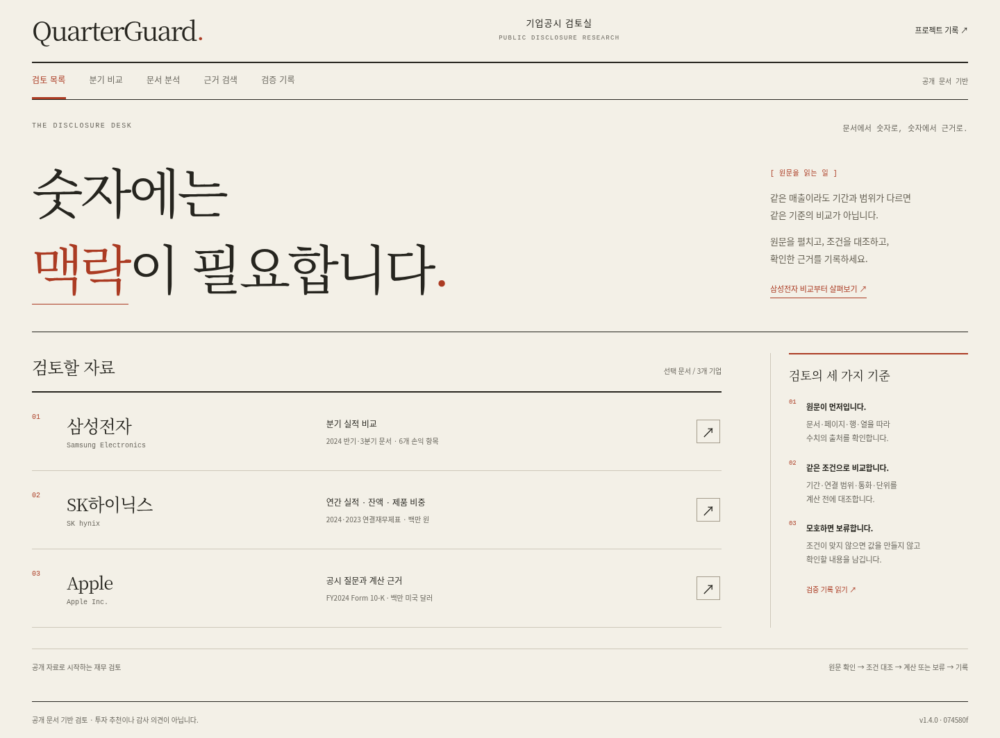
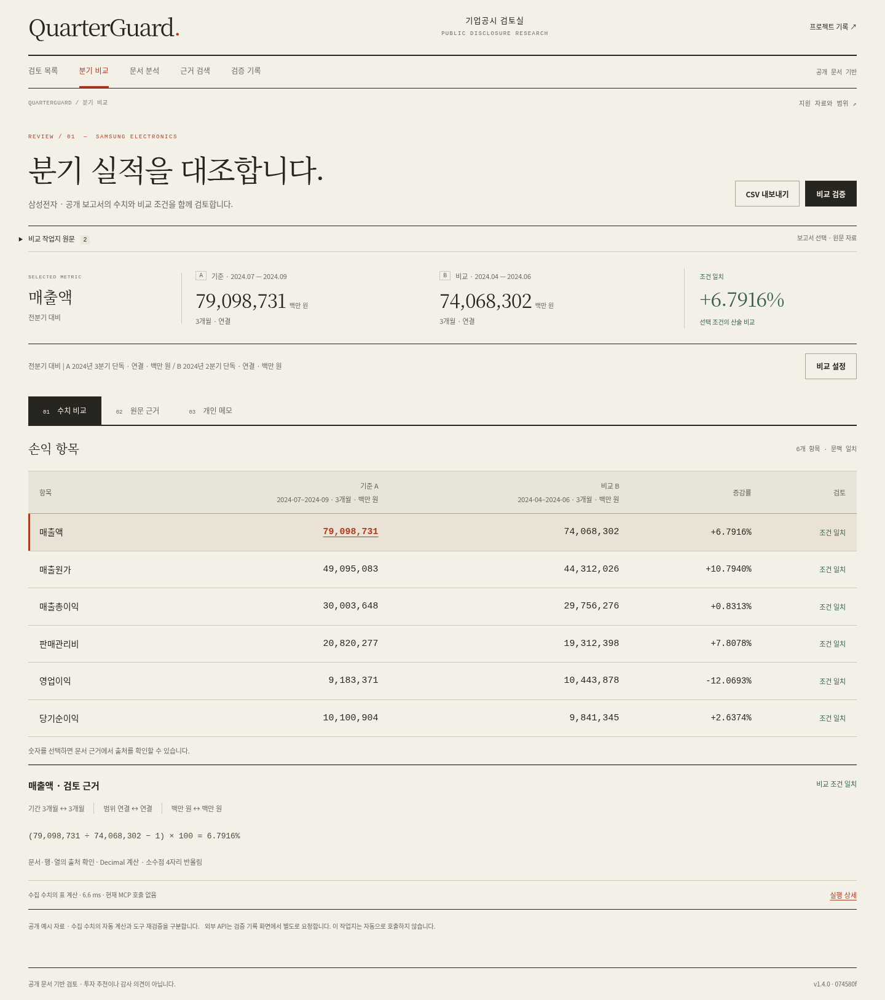

# 금융 리서치 편집 화면으로 디자인 교체 — 2026-11-14

앞선 C안과 task-workspace 화면이 같은 디자인처럼 보인다는 사용자의 지적에 따라 시각 체계를 교체했습니다. 고정 사이드바, 카드 격자, 흐름도와 둥근 패널을 없애고 상단 마스트헤드, 종이색 배경, 명조 제목, 가로 문서 목록과 전체 폭 장부를 적용했습니다. 비교·근거·메모·문서 분석·검색·검증 기록에 공통 적용합니다.

## 화면

로컬 실제 백엔드를 사용한 AI-operated Chromium 캡처입니다. 물리적 휴대폰·새 사람 검수 결과가 아닙니다. 캡처 당시 서버 기준 커밋은 변경 전 074580f이며 작업 디렉터리의 새 정적 파일을 제공했습니다. 공개 배포 커밋·검사는 연결 PR에 별도 기록합니다.

[모바일 첫 화면](screenshots/editorial-20261114/390-home.png) · [모바일 비교](screenshots/editorial-20261114/390-comparison.png) · [원문 근거](screenshots/editorial-20261114/1440-evidence.png) · [모바일 Apple](screenshots/editorial-20261114/390-apple.png)

## 검증

- browser_workspace_check.py: 320·390·1440px, 72개 확인 통과. 정상 비교, 기간·범위 차단과 복구, 원문 선택, 메모, 키보드·뒤로/앞으로, CSV, 실패 후 이전 결과 제거.
- browser_settings_return_check.py: 같은 3개 폭, 21개 확인 통과.
- browser_apple_support.py: PC·모바일 7개 기존 개발 질문, 계산·보류, 저장, 오류/시간초과/늦은 응답 차단 통과.
- browser_source_calculation_check.py: PC·모바일 시점 잔액, 음수 기준, 제품 비중, 기간 불일치, 정의 필요, 저장·복구 통과.
- browser_json_file_review.py: PC·모바일 A7/S4 실제 파일 저장·재열기·현재 결과 일치, 손상/큰 파일/읽기 실패·지연 결과 차단 통과.
- node --test tests/*.mjs: 30개 통과.

정상 계산은 실제 로컬 백엔드 실행입니다. 503, timeout, pending, file-read failure는 명시적 오류 주입입니다. 원문 PDF 자체의 새 파싱 평가가 아니며, 신규 유료 모델/API 호출·새 사람 참여는 0건입니다. 기존 평가·실패 기록과 이전 UI 기록은 보존했습니다.

## 글꼴·범위

Noto Serif CJK KR의 현재 UI 문자 subset을 Disclosure Serif로 이름을 변경하여 동일 출처 WOFF2로 제공합니다(104,280 bytes). OFL 라이선스는 web/fonts/NOTO-LICENSE.txt에 포함했습니다. 외부 폰트 서버에 의존하지 않습니다. 숫자 본문은 기존 고정폭 글꼴을 유지합니다.

financial backend, app.js, navigation.js의 계산/검증 코드는 이번에 수정하지 않았습니다. 두 삼성 원문 문서 선택은 비교 화면의 ‘비교 작업지 원문’ 펼침 영역으로 이동했습니다.
