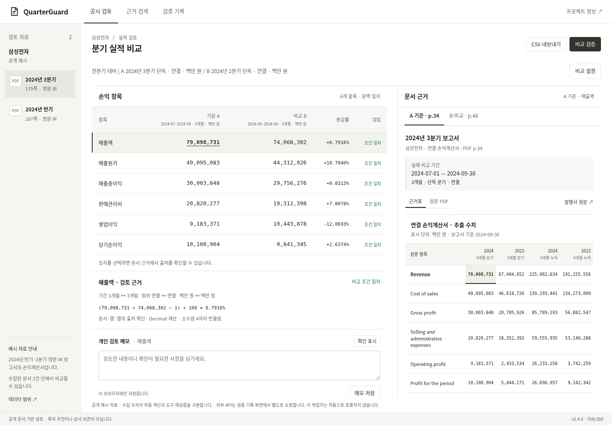
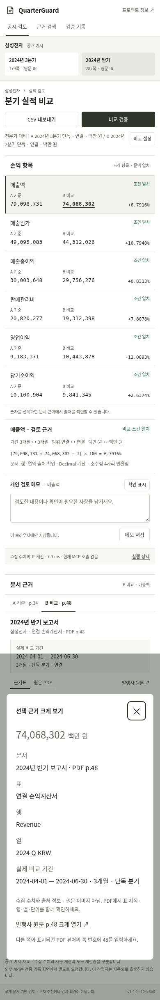

# 기록 정리와 피드백 반영 — 2026-11-08

## 이번에 마친 1~4번

|항목|상태|결과|
|---|---|---|
|1. README·현재 근거 정리|완료|143개 테스트와 실제 사용자 커밋/PR #14·배포 확인을 연결. 과거 실패·검증 기록은 보존.|
|2. 실제 참여 기록|완료|[세션 a](validation-kit/session-a-20261107.md)에 개발자 조작과 대학생 1명의 실제 의견을 구분. 역할에 맞지 않던 초기 양식 문구를 정정. 익명 공개 동의는 진행자가 확인한 범위로 기재.|
|3. 직접 코드 검토 근거|완료 — 확보된 범위|[검토 기록](code-review-kit/review-20261108.md)에 세 항목의 코드·테스트·질문 연결. 기간 테스트는 개인 실행·원본 커밋·CI 근거, 파싱/DART 검토는 본인 확인 진술로 구분.|
|4. 지원서·면접 자료|완료|[짧은/상세 소개와 질문별 근거](application-evidence-20261108.md). 고객 배포·전문가 검수·독립 개발·사용성 향상으로 확대하지 않음.|

## 실제 피드백에 따른 화면 변경

|의견|구현|남은 범위|
|---|---|---|
|작은 패널의 원문·행·열 확인이 번거롭다|선택 근거 확대 창에 금액·단위·문서·쪽·표·행·열·기간 표시. 발행사 PDF 해당 쪽 링크와 뷰어 쪽 번호 안내.|확대 내용은 수집 수치/출처 정보이며 원문 이미지가 아니다. PDF의 선택 셀 자동 확대·강조는 구현하지 않음.|
|반기 보고서와 2분기 단독의 차이가 헷갈린다|문서명 아래 실제 비교 날짜, 개월 수, 단독/누적을 별도로 강조. 비교표 열에도 개월 수 표시.|전체 지원 문서는 기존 삼성전자 2024 두 건으로 동일.|
|보류 안내에서 수정할 설정으로 이동하고 싶다|기간/범위 불일치 안내에서 B의 기간/범위 선택 항목으로 이동하고 키보드 초점 연결.|조건은 자동으로 바꾸지 않는다. 연도·비교 방식 등 다른 원인도 사용자가 함께 확인해야 한다.|

금융 계산·방어 코드와 정본은 변경하지 않았다. AI가 구현·검사한 화면 보완이며, 참여자가 개선 후 더 편리하다고 확인한 결과는 아직 없다.

## 검증 결과와 재현

|검사|결과|방식|
|---|---|---|
|Python 전체|143개 / 24.659초 / OK|AI 로컬 재실행; 사용자 46.507초 출력과 별개|
|Node 개인 메모·CSV|5개 통과|기존 테스트|
|정본·평가 파일 일관성|통과|`scripts/check_artifacts.py`|
|기존 작업지|37개 통과|실제 로컬 서버 + 일부 명시적 오류 주입, MCP 실행 포함|
|검색/평가 화면|10개 통과|한국어·영어·조건 누락·미지원 기업, 실제 로컬 서버|
|새 피드백 흐름|최종 14개 통과 (초기 12개 별도 보존)|PC 1440×1000 / 모바일 크기 390×844, 실제 로컬 서버|
|외부 API 화면|7개 통과|브라우저에서 준비된 응답 주입; 실제 DART/LLM 호출 아님|

새 검사에서는 확대 후 근거 변경 시 이전 금액이 남지 않는지, 닫기 후 초점 복귀, 설정 이동 후 보류 유지, 사용자가 범위를 맞춘 뒤 정상 비교 복구, 가로 화면 넘침을 확인했다. [실행 결과와 소스 해시](../artifacts/followup-20261108/manifest.json), [Python 출력](../artifacts/followup-20261108/python-tests.txt), [새 UI 검사](../artifacts/followup-20261108/feedback-local.json).

첫 UI 검사는 새 기간 표시 부재로 실패했다. 구현 후 다음 실행에서는 테스트의 기존 닫기 버튼 선택자 오기가 드러났으며 이를 수정했다. 초기 실패를 최종 통과로 소급해서 표시하지 않는다. [첫 실패 출력](../artifacts/followup-20261108/feedback-initial-missing-feature.txt), [중간 선택자 오류](../artifacts/followup-20261108/feedback-intermediate-test-selector-error.txt)를 별도 보존했다. 기존의 금융 문서 파싱 실패 파일과 과거 평가 수치는 변경하지 않았다.

```sh
python -m uvicorn quarterguard.api:app --host 127.0.0.1 --port 8005
# 다른 터미널에서 실행. 출력 폴더는 매번 새 이름을 사용한다.
FEEDBACK_QA_DIR=work/my-feedback-run python scripts/browser_feedback_check.py
QA_OUTPUT_DIR=work/my-worksheet-run python scripts/browser_check.py
DEMO_URL=http://127.0.0.1:8005 PRODUCT_QA_ARTIFACT=work/my-search-run.json python scripts/browser_product_v2.py
python -m unittest discover -s tests -v
node --test tests/test_review_notes.mjs
python scripts/check_artifacts.py
```

브라우저 재현에는 Playwright와 `/usr/bin/chromium`이 필요하다. 위 명령은 기본 제품 의존성만 설치한 모든 OS에서 바로 실행되는 명령은 아니다. 물리 휴대폰 검사는 미실시다. 공개 배포는 변경 PR의 최종 배포 확인과 `/health`로 확인하며 직접 HTTPS 브라우저와 TLS 검증 중계를 구분한다.

아래 캡처는 UI 코드 커밋 `704c3b0936a543eb3292a3e3460435eedb5e72eb`에서 새로 찍었다. 캡처 당시 코드의 해시는 초기 manifest에 보존했다. 최종 화면에는 USD 확대 창 안내가 추가됐으며 [최종 해시](../artifacts/followup-20261108/manifest-usd-followup.json)로 구분한다. 과거 캡처는 삭제하지 않았다.




## 별도 AI 리뷰 후 추가 수정

AI 리뷰에서 USD 확대 창에 참고 환산액 안내가 빠진 점을 발견했다. 기존 계산 차단은 유지됐고, 확대 창에도 환율·환산 주석 쪽·산술 비교 제한을 표시하도록 보완했다. [수정 전 실패](../artifacts/followup-20261108/feedback-usd-missing-warning.txt)와 [수정 후 PC/모바일 14개 검사](../artifacts/followup-20261108/feedback-usd-local.json)를 구분한다. 별도 AI가 재검토했고 남은 지적은 없었다. 사람 검수나 사용성 재평가가 아니다.

## 사람이 이어서 할 일

[금융 분야 지인에게 전달할 문안·업무 카드·빈 기록지](validation-kit/finance-peer-review.md)를 준비했다. 실제 직무·경력, 친구 관계, 개인/회사 자격, 동의 범위부터 확인한다. 가능하면 참여자가 직접 조작하도록 하고, 작성자 시연인 경우 그대로 적는다. 현재 추가 참여·금융 실무자 검수·고객사 접근/배포는 **미실시**다.

기존 기술 한계도 남아 있다: 현대 미지원 표, 작은 별도 평가 표본, AI 작성 정답의 사람 미검수, 자유 문장 전체 의미 검증 한계, 자율 LLM 도구 계획 미구현. 이 후속 작업에서 새 파싱/리랭킹/LLM 평가를 수행한 것으로 표현하지 않는다. 새 유료 API·DART 호출은 모두 0회이며 공급자 청구액은 조회하지 않았다.
