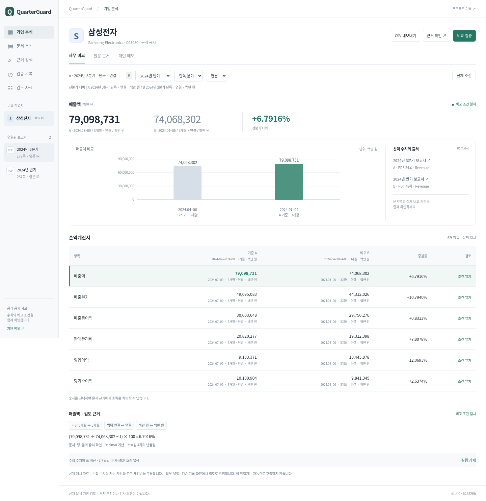

# 승인된 금융 분석 화면 적용

2026-11-14 UTC 작업. 사용자가 승인한 Fiscal.ai/Numeric 금융 분석 시안의 배치에 맞춰 실제 QuarterGuard API를 연결했습니다. 좁고 밝은 탐색 메뉴에는 Rogo의 메뉴 밀도만 참고했습니다. 외부 제품의 로고·화면 자산을 복제하지 않았습니다.

## 실제 변경

- 기본 진입은 삼성전자 비교입니다. 메뉴에서 문서 분석·근거 검색·검증 기록·검토 자료를 이동합니다.
- 회사 → 비교 조건 → 선택 수치/기간 → 두 기간 그래프/출처 → 손익표 순서입니다. 가상 시계열을 만들지 않습니다. 축은 0을 포함합니다.
- B 문서·단독/누적·연결/별도는 바로 변경합니다. 전체 조건에서 A/B 연도·문서·통화 및 QoQ/YoY도 설정할 수 있습니다. 두 설정은 동기화됩니다.
- 금액은 우측 출처 창을 엽니다. 문서·PDF쪽·행·열·기간·단위를 표시하며 발행사 PDF 및 기존 재구성 근거표/원문 보기로 이동합니다. 출처 창을 원문 이미지라고 표현하지 않습니다.
- 기간·범위·통화 등 비교 불가 상태에서는 그래프와 성장률을 보류합니다. 요청 중/실패 시 이전 그래프·출처 창·내보내기를 비웁니다.
- 메모·CSV·실제 MCP 재검증, Apple/SK 계산·JSON 저장/재열기, 기존 검증 기록은 유지합니다. 시험용 HTML의 저장 응답은 제품에 넣지 않았습니다.



[모바일 화면](ui-finance-20261114/mobile.png) · [모바일 기간 보류](ui-finance-20261114/mobile-hold.png) · [Apple 문서 분석](ui-finance-20261114/apple.png)

## 이번 기술 검증

AI가 Linux Chromium을 조작한 검사입니다. 새 사람 참여나 실기기 사용 기록으로 세지 않습니다.

- Python 전체 406개 실행, 실패 0·1개 skip. 기존 환경의 Starlette/Pydantic 경고 있음.
- Node 전체 37개 통과. 새 차트 테스트 7개: 입력 값/시간순서/0축, 음수·0 표시, 보류·통화·범위·단위·잘못된 수치 거부.
- 실제 로컬 API 브라우저 87개 점검(1440/390/320px). 정상 비교, 근거 창→상세, 탭 키보드, 메모 유지, CSV 다운로드, 누적/별도/USD 차단, YoY 연도 표시, 설정 동기화, 검색·라우팅, Apple/SK 분석을 포함합니다. [결과](../artifacts/ui-finance-20261114/browser.json)
- 별도 기존 SK 계산 회귀: PC/390px의 현금·음수 기저·제품 비중·재고 보류, 저장, 오류/복구/늦은 응답 차단. [결과](../artifacts/ui-finance-20261114/sk-calculations.json)
- Apple 기존 7질문 PC/390px 실제 계산/보류·저장·수정 후 무효화 회귀 통과.
- A7/S4 실제 다운로드 파일을 File API로 다시 읽어 대조. PC/390px 일치, 파일 읽기 네트워크 전송 0회. [결과](../artifacts/ui-finance-20261114/json-reopen.json)
- 현재 로컬 MCP 비교 1회 실행: 실제 도구 18회, 생성형 모델 0회. [기록](../artifacts/ui-finance-20261114/mcp.json)
- `python -m quarterguard.evaluate --cases-only`와 `python scripts/check_artifacts.py` 통과. 이번 실행 출력은 기존 실패/평가 원기록에 덮어쓰지 않고 별도 보관했습니다.
- API 503·시간초과·지연 응답은 테스트가 주입한 실패입니다. 실서비스 장애 관측으로 세지 않습니다. 유료 LLM/외부 공급자 호출 0회, 이번 평가의 모델 비용 $0. 청구액은 조회하지 않았습니다.

## 재현

```bash
python -m uvicorn quarterguard.api:app --host 127.0.0.1 --port 8021
# 다른 터미널
DEMO_URL=http://127.0.0.1:8021 WORKSPACE_QA_DIR=work/finance-check-new python scripts/browser_finance_workspace.py
node --test tests/*.mjs
python -m unittest discover -s tests
```

출력 디렉터리는 새 경로를 사용해야 합니다. `browser_finance_workspace.py`는 브라우저 상태와 실제 API를 점검하며 외부 공급자 호출을 하지 않습니다.

배포 확인은 아래 후속 절에 기록합니다. 이 로컬 검증을 공개 HTTPS 브라우저 검사나 사람의 재확인으로 바꾸어 표현하지 않습니다.
