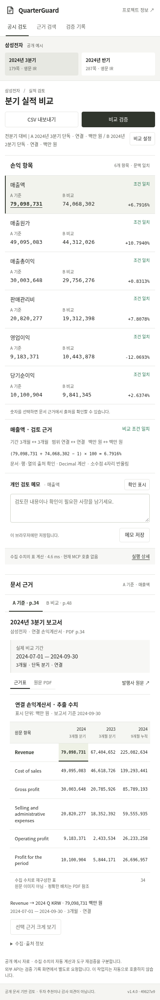
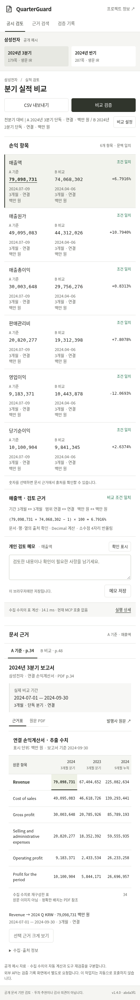

# 모바일 금액 아래 비교 조건 표시 — 2026-11-08

[b의 모바일 직접 수행 기록](validation-kit/session-b-task-followup-20261108.md)에서 나온 요청을 반영했다. 앞선 문서·코드 의견과 이번 직접 수행, 이후 AI 구현·검사를 별도로 기록한다.

## 변경 내용

- 화면 폭 600px 이하에서 여섯 손익 항목의 A/B 금액 각각 아래에 **실제 기간 / 개월 수·연결 범위 / 단위**를 표시한다. 예: `2024.07–09 / 3개월 · 연결 / 백만 원`.
- 표시값은 문서명이나 고정 기본값이 아닌 **각 API 결과의 해당 정본**에서 가져온다. B를 누적·별도·전년·USD로 바꾸면 그 수치의 설명도 함께 바뀐다. USD에는 `천 USD · 참고`를 표시한다.
- 금액 버튼의 접근성 설명을 해당 조건에 연결한다. B의 설명을 눌러도 B의 근거를 선택한다. PC에서는 기존 열 머리글 표시를 유지한다.
- 금융 계산·불일치 차단·정본·CSV는 변경하지 않았다. 조건을 각 행에 반복 표시하므로 모바일 표의 세로 길이가 늘어난다. 보류 안내까지의 스크롤과 CSV 코드 해석 문제는 별도 과제로 남는다.

코드: [`valueContext`와 `render`](../web/app.js), [모바일 스타일](../web/style.css). 구현 커밋: `abda3f1f9e5ac2a168297954eff4bac1eff9e041`.

## 자동 검증

|검사|결과·범위|
|---|---|
|새 모바일 조건 검사|15개 통과. 320×844·390×844 및 PC 1440×1000. 실제 로컬 서버, 오류 복구 항목만 503 응답 주입.|
|기존 작업지 회귀|37개 통과. 정상 비교·조건 차단·출처·실제 MCP·기록 재생·실패 주입을 구분한 기존 검사.|
|기존 확대/설정 이동 검사|14개 통과. USD 안내 포함.|
|Python 전체|143개 / 27.688초 / OK. AI 로컬 실행이며 작성자 개인 테스트 시간이나 제품 성능 수치가 아님.|
|Node 메모·CSV|5개 통과.|
|기존 평가 artifact 검사|통과. 과거 파싱 실패·정답·평가 파일 변경 없음.|

처음에는 금액 아래 조건이 없어 새 검사가 실패했고, 구현 후 통과했다. [수정 전 실패](../artifacts/mobile-context-20261108/before-failure.txt), [수정 후 결과](../artifacts/mobile-context-20261108/mobile-local.json), [회귀 결과·코드 해시](../artifacts/mobile-context-20261108/manifest.json), [Python 출력](../artifacts/mobile-context-20261108/python-tests.txt)를 추가로 보존한다.

새 검사는 양쪽 조건이 섞이지 않는지, 누적/별도 보류 유지, 전년 자료의 실제 연도 표시, USD 참고 단위와 보류, 실패 시 이전 설명 제거·재시도 복구, B 설명 클릭 시 B 근거 유지, 가로 넘침을 확인한다. 별도 AI 리뷰도 15개 검사를 재실행했고 지적 사항은 없었다. 이는 b의 변경 후 재검토가 아니다.

```sh
python -m uvicorn quarterguard.api:app --host 127.0.0.1 --port 8005
# 다른 터미널. 이전 결과를 덮어쓰지 않도록 새 출력 폴더 사용.
MOBILE_CONTEXT_QA_DIR=work/my-mobile-context-run python scripts/browser_mobile_context_check.py
```

브라우저 재현에는 Playwright와 `/usr/bin/chromium`이 필요하다. 자동 검사는 모바일 크기 화면이며 실제 휴대폰 사용 기록은 [b의 별도 수행 보고](validation-kit/session-b-task-followup-20261108.md)다. 새 유료 API·DART 호출은 0회이며 청구액을 조회하지 않았다.

## 화면과 해석

변경 전은 기존 공개 서버 `49627e9`의 TLS 검증 중계 캡처이고, 변경 후는 로컬 코드 `abda3f1`의 캡처다. 둘 다 390×844 자동 브라우저 검사이며, 서로 다른 환경의 화면을 사용자 작업시간이나 만족도 비교로 해석하지 않는다. 공개 배포 후 확인은 변경 PR에 별도로 기록한다.




남은 사람 검증: b가 변경된 화면에서 같은 조건을 읽고 더 명확한지 확인하는 단계. 기존 직접 수행 결과를 개선 후 성공 결과로 재사용하지 않는다.

**2026-11-09 후속:** 위 문장은 구현 당시 상태다. 이후 [b의 개선 후 직접 재확인 보고](validation-kit/session-b-mobile-recheck-received-20261109.md)를 별도로 받았다. 기본 조건 읽기, 누적·별도 보류 및 복구를 추가 도움 없이 수행했다고 보고했고, 수정 버튼까지 스크롤해야 한다는 불편은 남았다. 수행 날짜·배포 SHA·시간 단축 수치는 이번 제출에 없어 임의로 보완하지 않았다.
