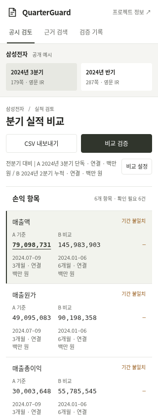
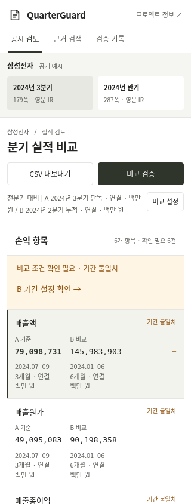

# 비교표 위에서 기간·범위 설정으로 이동 — 2026-11-09 KST

[b의 개선 후 재확인](validation-kit/session-b-mobile-recheck-received-20261109.md)에서 남은 불편은 수정 버튼이 여섯 손익 항목 아래에 있다는 점이었다. 이 기록을 바탕으로 비교표 바로 위에서도 필요한 설정으로 이동하도록 보완했다. 아래는 AI 구현·자동 검사이며 b가 이번 변경까지 다시 확인한 기록이 아니다.

## 변경

- 실제 비교 응답에 기간·연결 범위 불일치가 있으면 첫 손익 행보다 앞에 안내와 **B 기간 설정 확인 / B 범위 설정 확인** 버튼을 표시한다. 여섯 행에 같은 문제가 있어도 버튼을 중복 생성하지 않는다.
- 버튼은 비교 설정을 열고 해당 입력란으로 스크롤·키보드 초점을 이동한다. 선택 값과 계산 보류는 사용자가 직접 조건을 바꾸기 전까지 유지한다. 기존 아래쪽 근거 설명과 이동 버튼도 유지한다.
- 정상 결과, 해당 불일치 해소, 새 계산 대기, API 실패에서는 이전 버튼을 제거한다. 통화·참고 환산 문제만 있을 때 기간·범위 수정 버튼을 제시하지 않는다. 그 보류 사유는 기존 근거 영역에서 확인한다.
- 기존 작업지 흐름·금액 아래 조건 표시·원문 근거·금융 계산·CSV는 유지한다. 새 안내만큼 표 위 공간을 사용하지만 고정 배너로 내용을 가리지 않는다.

코드: [안내 생성·해제와 설정 이동](../web/app.js), [표 앞 배치](../web/index.html), [좁은 화면의 줄바꿈·버튼 영역](../web/style.css). 과거 참여 기록과 실패 평가는 변경하지 않았다.

## 검증

|검사|확인 결과|
|---|---|
|새 브라우저 검사|21개 통과. 화면 폭 320·390·1440. 최초 행보다 앞에 표시, 중복 제거, 키보드 이동, 값 유지, 일부/전체 해소, 통화 보류 구분, 대기·실패 시 제거와 재시도.|
|기존 작업지|37개 통과. 실제 MCP·준비된 결과 재생·실패 주입은 기존 검사의 범위대로 구분.|
|기존 근거 확대·설정 이동|14개 통과. 아래쪽 버튼의 검사를 `#finding`으로 한정해 기존 기능도 계속 검사.|
|기존 모바일 조건 표시|15개 통과.|
|Python 전체|144개 / 31.014초 / OK. AI 실행. 사용자의 이전 직접 실행 기록과 별개.|
|Node 메모·CSV / 평가 artifact|5개 통과 / 일관성 검사 통과.|

새 검사는 실제 로컬 백엔드를 사용했다. 지연·503 응답은 오래된 안내 제거를 확인하는 한 항목에서만 명시적으로 주입했다. 별도 AI 리뷰에서도 21개 검사를 재실행했고 차단할 문제를 찾지 못했다. 물리 휴대폰·참가자 검증이 아니다. [수정 전 실패](../artifacts/recovery-shortcuts-20261109/before-failure.txt), [최종 새 검사](../artifacts/recovery-shortcuts-20261109/local-recovery.json), [소스 해시·범위](../artifacts/recovery-shortcuts-20261109/manifest.json), [Python 출력](../artifacts/recovery-shortcuts-20261109/python-tests.txt).

```sh
python -m uvicorn quarterguard.api:app --host 127.0.0.1 --port 8005
# 다른 터미널에서 새 결과 폴더를 지정한다.
RECOVERY_QA_DIR=work/my-recovery-check python scripts/browser_recovery_shortcuts_check.py
```

## 전후 화면

둘 다 로컬 앱, 320px 자동 브라우저 화면이다. 수정 전은 `7a37a89` UI이고 수정 후는 위 manifest의 소스 해시로 식별한다. 로컬 서버의 버전 표시는 백엔드 시작 당시 커밋일 수 있으므로 화면 소스 해시와 구분한다. 공개 배포 결과·최종 커밋·직접 HTTPS와 TLS 검증 중계 여부는 변경 PR에 별도로 기록한다.




## 남은 사람 확인

실제 추가 참여 결과는 아직 없다. 진행자가 b에게 짧게 전달할 수 있는 요청:

> B를 누적으로 바꾼 뒤, 여섯 항목 아래로 내려가지 않고 수정 버튼을 찾을 수 있는지 확인해 주세요. 버튼을 누르면 B 기간 입력란으로 이동하는지, 단독 분기로 복구하면 안내가 사라지는지도 봐 주세요. 여전히 불편한 점이나 받은 도움이 있으면 그대로 알려 주세요.

|추가 참여자가 채울 항목|기록|
|---|---|
|수행 날짜·기기·화면 버전|미제공|
|버튼 위치 확인·입력란 이동·복구 결과|미수행 기록 상태|
|남은 불편·받은 도움|미제공|
|새 공개 발췌 확인|미확인|

이 요청을 AI가 참여자에게 전송하지 않았다. 시간 단축이나 사용성 향상은 측정하지 않았다. 새 유료 API 호출·요금제 변경은 없으며 청구액은 조회하지 않았다. 무료 서비스의 유휴 후 자동 재기동 한계는 [운영 기록](startup-availability-20261109.md)과 별개로 남아 있다.
