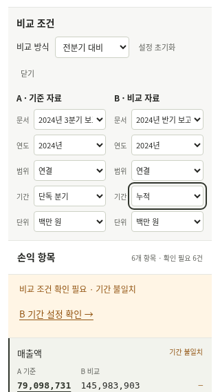
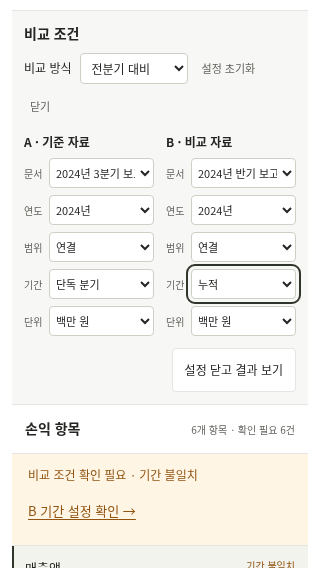

# 설정을 닫고 비교 결과로 돌아가기 — 2026-11-09 KST

모바일에서 B 조건을 바꾼 뒤 결과를 다시 읽으려면 설정 상단의 닫기 버튼을 찾거나 아래로 이동해야 했다. [b의 직접 확인 후속 의견](validation-kit/session-b-recovery-feedback-received-20261109.md)을 바탕으로 이번에는 **설정에서 결과로 돌아오는 동작** 하나를 보완했다. 참가자 의견과 이번 구현·자동 검사는 별도 기록으로 구분한다.

## 변경 내용

- A/B 선택칸 바로 아래, B 설정 가까이에 **설정 닫고 결과 보기** 버튼을 추가했다. 최소 높이는 44px이다.
- 버튼을 누르면 설정을 닫고 손익 항목 제목으로 스크롤·키보드 초점을 이동한다. 선택한 기간·범위, 비교 방식과 계산 판정은 바꾸지 않는다.
- 조건 변경 자체로 설정을 자동으로 닫지 않는다. 여러 조건을 이어서 바꾼 뒤 사용자가 버튼을 눌러 돌아올 수 있다. 상단의 기존 닫기 버튼도 유지했다.
- 계산 중이면 현재 대기 상태로, 실행 실패·초기 자료 연결 실패면 표시 중인 오류 안내로 이동한다. 이전 성공 결과를 새 결과처럼 표시하지 않는다.

코드: [버튼·초점 대상](../web/index.html), [설정 종료·이동 처리](../web/app.js), [버튼 배치](../web/style.css). 금융 계산·비교 차단·정본·CSV 형식은 변경하지 않았다. 기간 설정 버튼의 기존 문구와 표/보류 안내의 정보량은 이번 변경에 포함하지 않았다.

## 자동 검증

|검사|결과|
|---|---|
|새 결과 복귀 검사|21개 통과. 320×568, 390×844, 1440×900. B 기간 초점에서 버튼 접근, 키보드 복귀, 첫 행 표시, 기간·범위 보류 유지, 정상 복구, 계산 대기·실행 실패·초기 연결 실패.|
|기존 표 위 설정 이동|21개 통과.|
|기존 작업지 / 근거 확대 / 모바일 금액 조건|37개 / 14개 / 15개 통과.|
|Python 전체 / Node|144개, 33.523초, OK / 5개 통과.|
|기존 평가 artifact|일관성 검사 통과.|

실제 로컬 백엔드를 사용했고 대기·503 오류와 초기 자료 조회 오류만 명시적으로 주입했다. 새 검사에서 수정 전 버튼이 없어 실패한 기록을 보존했다. 초기 연결 실패 화면의 바깥 테두리가 스크롤 반올림으로 0.421875px 위로 이동해 엄격한 검사에 실패한 기록도 남겼다. 실제 제목·설명·재시도 버튼은 모두 보였으므로 검사 대상을 이 내용으로 바꿨다. 제품 코드를 바꿔 실패를 숨기지 않았다. 별도 AI 리뷰가 최종 21개를 재실행해 통과했다.

[소스 해시·검증 범위](../artifacts/settings-return-20261109/manifest.json) · [수정 전 실패](../artifacts/settings-return-20261109/before-failure.txt) · [테두리 검사 실패](../artifacts/settings-return-20261109/fractional-border-test-failure.txt) · [최종 21개 결과](../artifacts/settings-return-20261109/local-return.json) · [Python 출력](../artifacts/settings-return-20261109/python-tests.txt).

```sh
python -m uvicorn quarterguard.api:app --host 127.0.0.1 --port 8005
# 다른 터미널, 이전 결과를 보존하도록 새로운 출력 폴더 지정
SETTINGS_RETURN_QA_DIR=work/my-settings-return python scripts/browser_settings_return_check.py
```

## 전후 화면과 한계

둘 다 320×568 로컬 자동 브라우저 화면이다. 수정 전 UI는 `53aaa94`, 수정 후 UI는 manifest 소스 해시로 식별한다. 로컬 백엔드의 버전 표시는 편집 중인 프런트엔드 버전을 입증하지 않는다. 공개 배포와 서버 커밋·파일 일치는 변경 PR에서 별도로 확인한다.




자동 검사는 물리 휴대폰·사람 참여 검증이 아니다. 이번 결과 복귀 기능의 사람 재확인과 작업시간 단축 측정은 아직 없다. 이전 참가자 기록을 이번 변경의 성공 결과로 재사용하지 않는다. 새 유료 API 호출·요금제 변경은 없으며 청구액은 조회하지 않았다. 공개 서비스의 유휴 재기동 문제는 별도 운영 기록의 범위를 유지한다.
