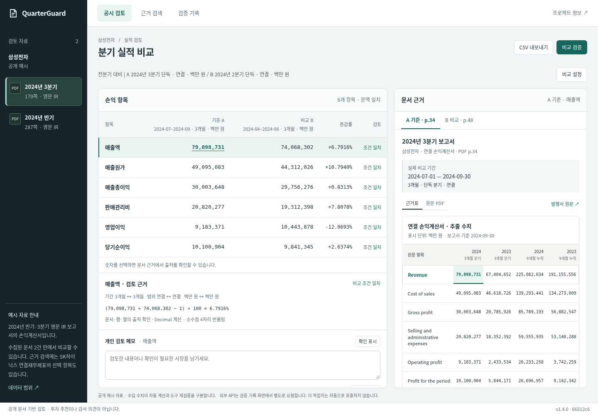

# C안 화면 개선 — 2026-11-14

사용자가 UI 조사 후 선택한 **짙은 탐색 영역 + 밝은 검토 작업지**를 적용했다.
제품 변경은 `web/style.css`에 한정된다. 계산·검색·MCP·저장 로직은 변경하지 않았다.
기준 코드는 `66512c661068baae2a49c05b67e3c018c0a44608`이다.

## 변경
- 왼쪽 문서 목록과 로고 영역: 짙은 청록색. 모바일은 상단 탐색 영역에 적용.
- 중앙: 옅은 회색 배경 위에 흰 비교표와 흰 문서 근거 패널을 구분.
- 청록색 버튼·선택 행·선택 근거 셀을 연결하고 문서 목록은 밝은 선택 표시 사용.
- 작은 보조 글자 일부 확대, 숫자 자리 정렬 유지, 어두운 영역의 초점 표시 별도 지정.
- 모바일 A/B 금액 아래 기간·연결 범위·단위, 보류 안내와 복구 동작 보존.

## 화면
아래는 로컬 HTTP 서버에서 새 CSS와 실제 백엔드를 실행한 자동 브라우저 캡처다.
캡처 당시 서버 커밋 표시가 기준 커밋인 것은 커밋 전 작업 트리를 실행했기 때문이다.
새 사람 사용 기록이나 공개 HTTPS 브라우저 검사를 의미하지 않는다.



[모바일 C안](../artifacts/ui-c-20261114/after-390.png) ·
[PC 변경 전](../artifacts/ui-c-20261114/before-1440.png) ·
[모바일 변경 전](../artifacts/ui-c-20261114/before-390.png)

## 검증
|검사|결과|범위|
|---|---|---|
|기존 Node 테스트|30/30 통과|변경 전과 후 모두 통과|
|기존 작업지 브라우저 검사|37개 통과|정상 비교, 보류, 근거 선택, 검색, 메모·저장, 오류 복구|
|설정 복귀 브라우저 검사|21개 통과|320·390·1440px, 키보드 복귀, 기간/범위 보류, 대기·503·초기 로딩 실패|
|Apple 기존 7개 질문|PC·모바일 통과|실제 백엔드, JSON 다운로드, 입력 변경·타임아웃·503·늦은 응답 처리|
|SK·삼성 회귀|PC·모바일 통과|SK 잔액 47.6820%, 삼성 분기 6.7916%|
|페이지 가로 넘침|없음|320·390·768·1280·1440px의 검토·검색·기록 화면|
|독립 코드 검토|중요 문제 없음|추가 경계 폭 700/701/1200/1201px 등 확인|

주요 색상 대비: 흰 글자/주 버튼 6.68:1, 탐색 보조 글자/선택 배경 5.97:1.
이는 확인한 색상 조합의 검사이며 전체 WCAG 인증은 아니다.
모바일 패널 모서리의 일부 배경이 기존 overflow 규칙 때문에 각져 보이는 점은
외관상 개선 후보이며 읽기·조작 검사에 영향은 없었다.

자동 브라우저는 Linux Chromium이며 실기기 사람 검수와 구분한다.
기존 스크립트의 실패·시간 초과는 의도적으로 주입한 사례다.
작업지 스크립트는 발행사 PDF URL·쪽수 및 실패 시 대체 표시를 확인하며,
이번 검사에서 외부 PDF 자체가 실제로 렌더링됐다고 주장하지 않는다.
유료 API 호출 0회. 신규 사람 검수 0건.

## 재현
```sh
python -m uvicorn quarterguard.api:app --host 127.0.0.1 --port 8804
node --test tests/*.mjs
DEMO_URL=http://127.0.0.1:8804 QA_OUTPUT_DIR=/tmp/qg-ui-new-run python scripts/browser_check.py
DEMO_URL=http://127.0.0.1:8804 SETTINGS_RETURN_QA_DIR=/tmp/qg-return-new-run python scripts/browser_settings_return_check.py
python scripts/browser_apple_support.py --url http://127.0.0.1:8804 --output /tmp/qg-apple-new-run
```
출력 디렉터리는 매 실행마다 새 경로를 사용한다.
원본 로그·전후 캡처는 [별도 폴더](../artifacts/ui-c-20261114)에 보존했다.
기존 b의 사용 검수는 당시 화면에 대한 근거이며 이번 색상 변경의 사람 검수가 아니다.

## 참고
[Linear 영역 구분](https://linear.app/now/how-we-redesigned-the-linear-ui),
[Numeric 비교표](https://www.numeric.io/product/variance-analysis),
[DataSnipper 문서 대조](https://knowledge.datasnipper.com/en/articles/685955-how-to-document-your-audit-procedures-with-datasnipper),
[Koyfin 탐색 영역](https://www.koyfin.com/help/mydashboards-myd/).
공식 공개 화면·설명에서 디자인을 참고했으며 타사 기능·성능을 구현한 것으로 주장하지 않는다.
