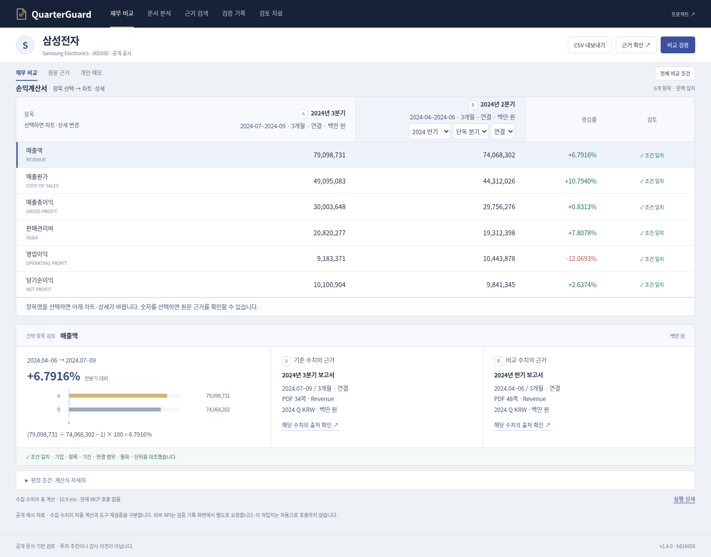
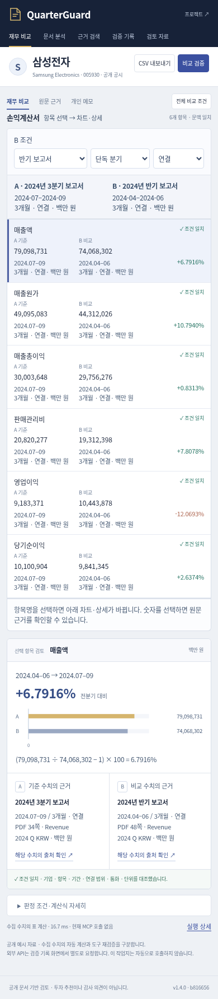
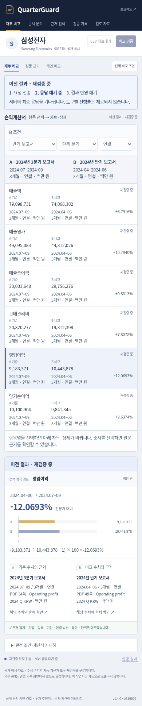

# 재검증·가독성·항목 선택 피드백 반영

기준 `b816656`의 승인된 표 중심 디자인에 세 가지 사용성 피드백을 반영했다. 사용자 피드백은 제공받은 내용이며, 아래 검사는 AI가 실행한 자동 검사다. 새로운 사람 참여 기록으로 집계하지 않는다.

## 변경과 결과 처리

- 같은 조건으로 실제 MCP 재검증을 요청할 때 이전 표와 선택 항목의 차트를 유지한다. 표 위·행 판정·차트에 이전 결과 / 재검증 중임을 표시한다. 이전 결과는 저장·내보내기하거나 새 성공 결과처럼 선택할 수 없다.
- 상태 표시는 요청 전송 → 응답 대기 → 새 결과 반영이다. 서버가 마지막 응답만 반환하므로 내부 도구별 진행 단계·완료 비율을 만들어 표시하지 않는다. 성공 후 실제 도구 기록은 실행 상세에서 확인한다.
- 문서·연도·기간·범위·통화·비교 방식 중 하나라도 바뀌면 이전 결과를 즉시 제거한다. HTTP 오류·도구 시간 초과·네트워크 중단·빈 성공 응답도 이전 표/차트/내보내기를 제거한다. 실패 후 다시 검증할 수 있다.
- PC 기간·단위·빠른 선택 메뉴 10→12px, 선택칸 최소 높이 25→32px. 모바일 값 아래 기간·단위 8/9→11px, 선택칸 12px/최소36px. 핵심 보조문구 색상은 #485b74로 높였다. 가독성을 위해 모바일 세로 길이는 늘어났다.
- 표 위와 아래에 항목명 → 차트·상세, 숫자 → 원문 근거 안내를 추가했다. 항목 버튼의 선택 상태·키보드 초점도 유지한다.

## 검증

|검사|결과|
|---|---|
|Python 회귀|406개 실행, 실패0, 건너뜀1|
|Node|39개 통과. 2개 신규 테스트에서 유지 조건 및 모든 조건 변경 차단 확인|
|기존 실제 로컬 API/브라우저 흐름|47개 통과. 실제 MCP18개 호출, 유료 제공자 호출0|
|재검증 상태 검사|1440/390/320px, 18개 통과. 요청 지연·응답 재생·오류 주입으로 대기/실패 상태 검사|
|배치|1440px 첫 행 y287.8, 여섯째 행 하단602.3. 모바일320/390px 가로 넘침 없음. 숨은 PC 선택칸의 Tab 진입 차단 유지|

재검증 상태 검사에서 성공 응답은 실제 로컬 preview API 응답의 재생이다. 이 18개를 실제 MCP 실행 횟수로 세지 않는다. 별도 전체 흐름 검사의 MCP18개는 실제 stdio 도구 실행이다. 브라우저의 네트워크 timedout 주입과 서버 TOOL_TIMEOUT 응답 주입을 구분했다. 실제 60초 경과를 기다린 네트워크 장애 실험은 아니다.

[대기·실패 검사](../artifacts/workbook-feedback-20261115/pending-checks.json) · [전체 흐름](../artifacts/workbook-feedback-20261115/browser.json) · [배치 측정](../artifacts/workbook-feedback-20261115/layout.json)

아래는 변경 파일을 제공하는 로컬 서버 캡처다. 캡처 하단의 서버 버전은 정적 파일 수정 전 프로세스의 기준 커밋이며, 공개 배포 버전을 뜻하지 않는다. 공개 배포 검증은 PR의 최종 결과와 `/health`를 확인한다.





## 재현

```bash
node --test tests/*.mjs
python -m unittest discover -s tests
python scripts/check_workbook_layout.py --url http://127.0.0.1:8000
python scripts/check_verification_feedback.py --url http://127.0.0.1:8000
python scripts/check_workbook_browser.py --url http://127.0.0.1:8000
```

실행 서버는 `python -m uvicorn quarterguard.api:app --port 8000`으로 시작한다. 위 검사는 유료 제공자를 호출하지 않는다. 기존 실패·모델 평가·사람 검수 기록은 변경하지 않았다.
