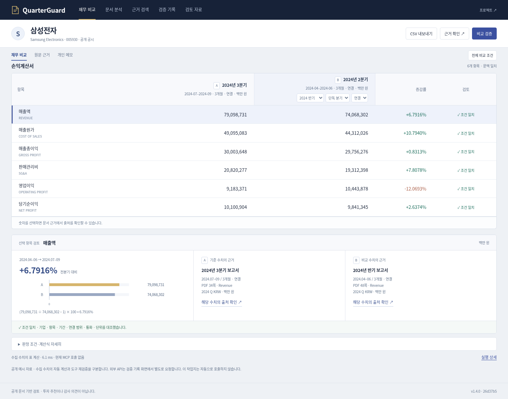
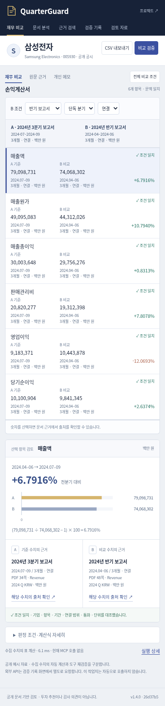

# 워크북 공개 배포 확인 — 2026-11-15 KST

이 문서는 PR #85의 공개 배포 후 검사입니다. 이후 README 정리 커밋과 캡처 당시 앱 커밋을 구분합니다.

- 공개 앱: https://quarterguard.onrender.com/#work
- PR: https://github.com/sokldjs554/quarterguard/pull/85
- 검증한 배포 커밋: `26d37b5625167c39a68891751103c05299f7b3aa`
- Render 배포: `dep-dbs8ihmq1p3s73ehbk60`, live `2026-11-14T16:17:20.673157Z`
- GitHub main·Render·health 일치 및 HTML/CSS/JS 5개 파일 SHA-256 일치 확인.
- 공개 기능 45항목 통과. 실제 MCP 비교 1회에서 18개 도구 실행. 유료 제공자 호출 0회.
- 1440/390/320px 배치와 모바일 키보드 순서 확인.
- 검사 수행: AI Playwright. 새 사람 실사용 기록 아님.

[공개 기능 보고서](../artifacts/workbook-public-20261115/browser.json) · [배치](../artifacts/workbook-public-20261115/layout.json) · [health·자산·TLS](../artifacts/workbook-public-20261115/version-assets.json) · [Render 배포](../artifacts/workbook-public-20261115/deployment.json) · [PR CI](../artifacts/workbook-public-20261115/github-ci.json).

## 검사 경로

직접 HTTP 클라이언트의 HTTPS 요청은 인증서를 검증한 상태에서 성공했습니다. 이 환경의 직접 Chromium HTTPS는 `ERR_CERT_AUTHORITY_INVALID`로 실패했습니다. 브라우저 기능 검사는 고정 원본 `https://quarterguard.onrender.com`의 TLS를 검증하는 로컬 중계를 사용했습니다. 인증서 검증을 끄지 않았으며 직접 HTTPS 브라우저 성공으로 기록하지 않습니다.

## 재현

```bash
python scripts/check_workbook_browser.py --url http://127.0.0.1:8022 --tls-relay --commit 26d37b5625167c39a68891751103c05299f7b3aa --no-failure-injection --out /tmp/workbook-public
python scripts/check_workbook_layout.py --url http://127.0.0.1:8022 --out /tmp/workbook-layout
```

이 명령은 `scripts/https_qa_relay.py`의 FastAPI 앱이 8022 포트에서 실행 중인 검사 환경을 전제로 합니다. 커밋 인수는 재검사할 실제 배포 버전으로 바꿉니다. 일반 사용자는 공개 HTTPS 주소에 직접 접속하면 됩니다. 브라우저 스크립트에는 Playwright와 `/usr/bin/chromium`이 필요합니다.

## 캡처



<details><summary>모바일 공개 화면</summary>



</details>
