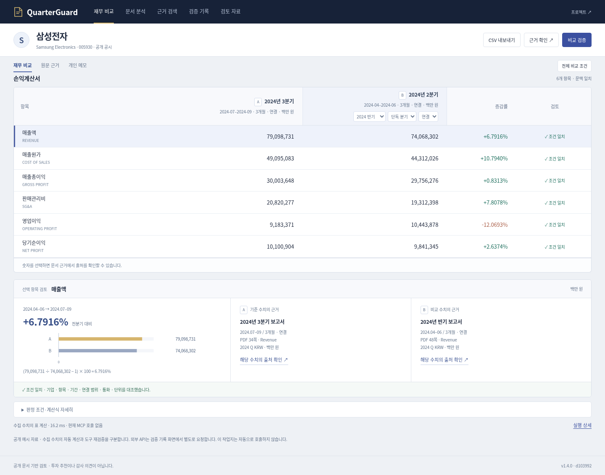
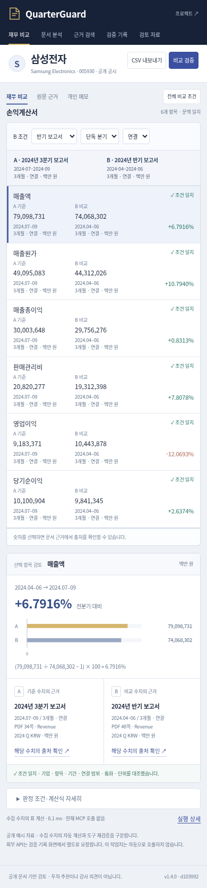

# 승인된 워크북 디자인의 실제 제품 적용

사용자는 이전 화면과 비교한 시안을 확인하고 “그래 괜찮네 진행해도 돼”라고 승인했습니다. 이번 변경은 승인 시안의 구조를 기존 제품 기능에 연결합니다. 새 사람 실사용·성능 향상 측정이 아닙니다.

## 화면 구조 대조

|항목|직전 공개 금융 화면|승인 시안|이번 실제 제품|
|---|---|---|---|
|탐색|왼쪽 고정 메뉴|상단 작은 메뉴|상단 실제 5개 작업 메뉴|
|첫 작업|큰 금액 요약과 그래프|6행 재무표|전체 조건과 연결된 6행 재무표|
|선택 항목|위쪽 요약과 큰 그래프|표 아래 계산·A/B 출처|표 아래 계산·A/B 출처, 상세 근거·개인 메모 유지|
|첫 행 y, 1440×1000|785.953px|291.5px|298.391px|
|마지막 행 하단|1157.859px|594px|612.891px|
|모바일|가로 스크롤 표|A/B와 판정 동시 표시|A/B·판정, 각 금액 아래 실제 기간·범위·단위 유지|
|실제 기능|MCP·검색·저장 가능|삼성 4개 조건 검토용|전체 조건/YoY/USD·MCP·메모·기존 25열 CSV·Apple/SK·JSON 연결 유지|

레이아웃 위치는 화면 배치 측정이며 작업시간 개선률이 아닙니다. 처음 제품 이식의 첫 행은 308.391px로 300px 기준을 넘었고, 간격을 줄여 298.391px로 수정했습니다.

## 요구사항 대조

1. **색상만 변경하지 않기:** 왼쪽 메뉴를 제거하고 표 위의 대형 요약·그래프를 아래 선택 항목 검토로 옮겼습니다.
2. **금융 검토 흐름:** 원문 → 조건 → 계산/보류 → 기록 유지. 채팅 화면으로 변경하지 않았습니다.
3. **참고 방향:** 숫자 열과 기간 조건 중심으로 구성하고 작은 탐색 메뉴를 적용했습니다.
4. **삼성 공개 예시:** 실제 `/api/worksheet` 결과를 표시합니다. 시안의 저장 응답을 제품 코드에 포함하지 않았습니다.
5. **만드는 중 비교:** 직전/승인 시안/제품을 동일 viewport로 측정했습니다. 미달과 수정 이력을 보존합니다.
6. **요구별 확인:** 이 목록, 브라우저 재현 스크립트와 측정 JSON을 제공합니다.
7. **기존 기능·기록:** API·재무 판정·메모 키·기존 실패/사람 검수 기록은 변경하지 않았습니다. 새 검수로 집계하지 않습니다.
8. **PC·모바일:** 1440/390/320px 배치. 실제 API의 정상·보류·복구·출처·저장 흐름 확인.
9. **승인 후 반영:** 별도 시안 확인 후 받은 진행 승인에 따라 실제 앱에 적용합니다. 과거 공개·Render 배포 승인 범위에서 검증 후 반영합니다.

## 검증

- Python `python -m unittest discover -s tests`: 406개 실행, 실패 0, 1개 skip. 환경 경고 포함 원로그 보존.
- Node `node --test tests/*.mjs`: 37개 통과.
- `python -m quarterguard.evaluate --cases-only` 실행과 `scripts/check_artifacts.py`의 기존 8개 사례·원문/정답 해시·정확한 인용 일치 검사 통과. 유료 모델 호출 없음.
- 실제 API 브라우저: 1440/390px 47항목 통과. 삼성 정상·기간/범위/동시 불일치·복구·YoY·USD, 근거표, 개인 메모/확인 표시, CSV 6행·25열, 검색→작업지, Apple 계산/보류/질문 변경, SK 잔액/제품 비중/재고 보류, JSON 저장·재열기, 기존 기록.
- 실제 로컬 MCP 18개 도구 호출. 별도 코드 검토자의 반복 실행에서도 같은 47항목·18개 실제 도구 실행 확인. 두 실행은 새 사람 실사용이 아닙니다.
- HTTP 503은 브라우저 주입 실패입니다. 이전 차트·원문 창·CSV 제거와 복구를 확인했습니다.
- 별도 코드 검토에서 모바일의 숨은 PC 선택칸이 Tab 순서에 남는 P2 발견. 재현 검사 실패를 먼저 확인한 뒤 모바일에서 해당 중복 컨트롤을 숨겨 수정했습니다. 390/320px 키보드 회귀 확인 통과.
- 유료 모델·외부 제공자 호출 0회. 서버 Python 코드는 변경하지 않았습니다.

[기능 점검 결과](../artifacts/workbook-release-20261115/local-browser.json) · [배치 측정](../artifacts/workbook-release-20261115/layout.json) · [MCP 기록](../artifacts/workbook-release-20261115/actual-local-mcp.txt)

## 화면

아래는 코드 커밋 전 실제 로컬 API 연결 캡처이며 하단 버전 표시는 기준 커밋 d103992입니다. 공개 서버 배포 버전의 증거로 대신 사용하지 않습니다. 배포 후 `/health`와 실제 자산 해시를 별도 확인합니다.




## 재현

```bash
python -m uvicorn quarterguard.api:app --host 127.0.0.1 --port 8021
python scripts/check_workbook_layout.py --url http://127.0.0.1:8021 --out /tmp/workbook-layout
python scripts/check_workbook_browser.py --url http://127.0.0.1:8021 --out /tmp/workbook-browser
```

브라우저 스크립트는 Playwright와 `/usr/bin/chromium`을 사용합니다. 두 번째 스크립트는 명시적으로 실제 MCP 비교 1회(18개 도구)를 실행하지만 유료 제공자는 호출하지 않습니다. 자동 브라우저 뷰포트 점검은 실물 모바일 기기 검증이 아닙니다.

공개 확인: [재무 비교](https://quarterguard.onrender.com/#work) · [문서 분석](https://quarterguard.onrender.com/#analysis) · [검색](https://quarterguard.onrender.com/#search) · [검증 기록](https://quarterguard.onrender.com/#review) · [health](https://quarterguard.onrender.com/health).
